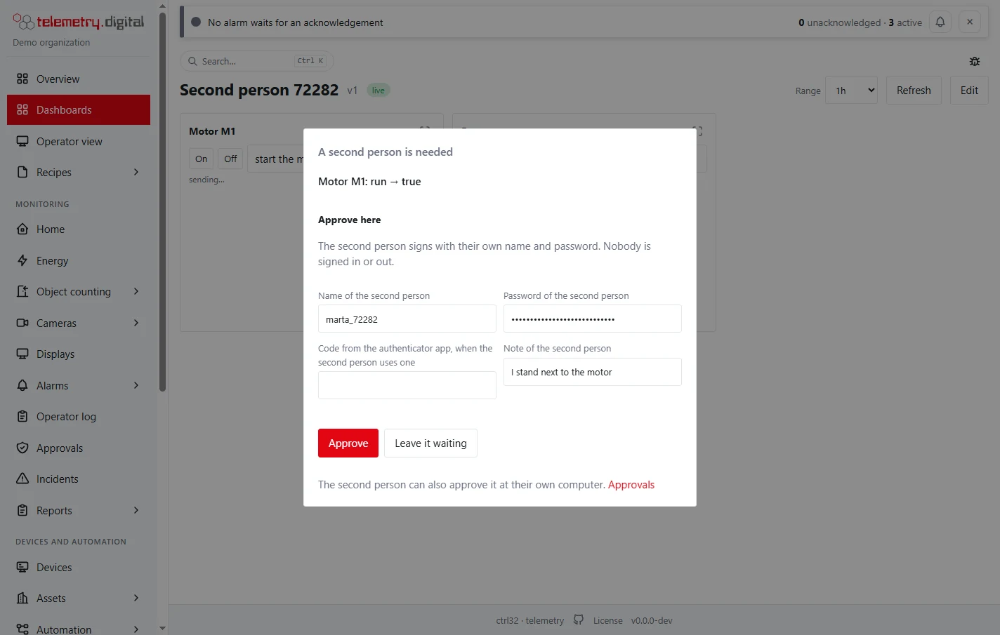
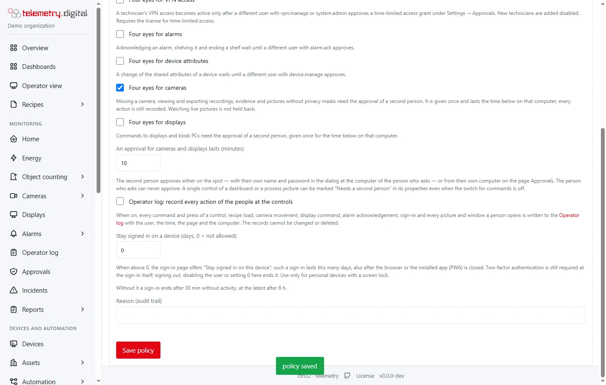
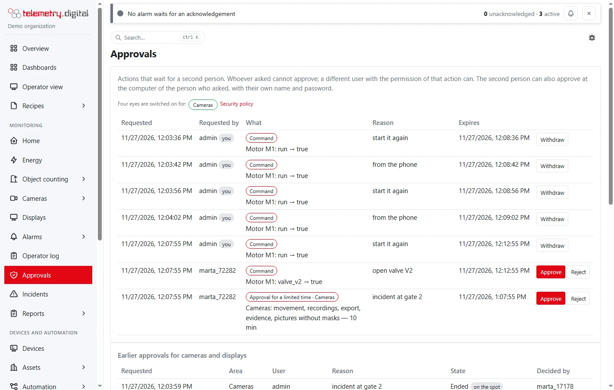
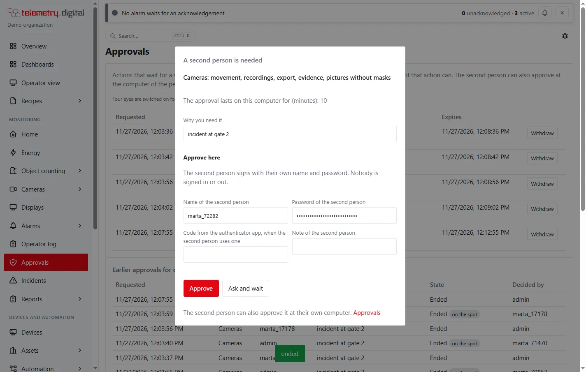

**Four eyes** means that an action needs a second person. Since 0.94.0 you can require it for every area of the
application and for a single control. Everything is switched off until you switch it on for your organization.

## Switching it on

*Settings → Security policy*, give a reason and save. You need the permission `user.admin`. The change is written to
the audit trail.

| Option | Default | Effect when on |
|---|:---:|---|
| Four eyes for commands | off | every command, recipe load and scene waits for a second person |
| Four eyes for alarm limits | off | a new alarm rule and disabling one wait |
| Four eyes for datastream assignments | off | assigning and removing a datastream on a device wait |
| Four eyes for VPN access | off | a technician's VPN access needs an approved, time-limited grant |
| Four eyes for alarms | off | acknowledging an alarm, shelving it and ending a shelf wait |
| Four eyes for device attributes | off | a change of the shared attributes of a device waits |
| Four eyes for cameras | off | moving a camera, viewing and exporting recordings, evidence and pictures without privacy masks need an approval that lasts the time below on one computer; watching live pictures is not held back |
| Four eyes for displays | off | commands to displays and kiosk PCs need an approval that lasts the time below on one computer |
| An approval for cameras and displays lasts (minutes) | 15 | 1 to 480 |

### A single control

A control of a dashboard — *Setpoint*, *Switch*, *Button*, *Knob*, *Slider*, *Round switch* — and an element of a
process picture with a device for operation have the property **Needs a second person**. Its command waits for a
second person even when *Four eyes for commands* is off.

| Property | Type | Default | Effect |
|---|---|:---:|---|
| Needs a second person | on / off | off | the command of this control is held until a second person approves it |

!!! note "What the mark does not do"
    The mark is applied by the page that sends the command. A program that calls the API itself with the permission
    `device.command` is bound by *Four eyes for commands*, not by the mark of a control.

## Approving

The person who asked can never approve. The second person needs the same permission as the action itself.

### On the spot

When an action is held, the page opens **A second person is needed**. The second person comes to the computer and
fills in:

| Field | Required | Notes |
|---|:---:|---|
| Name of the second person | yes | the user name or the e-mail address of their account |
| Password of the second person | yes | wrong passwords count towards the lockout of that account |
| Code from the authenticator app | when that account uses two-factor sign-in | 6 digits |
| Note of the second person | no | written to the audit trail; without it "approved on the spot" |
| Why you need it | for cameras and displays | the reason of the person who asks |

**Approve** runs the action at once. Nobody is signed in or out: the session of the computer stays that of the person
who asked. **Leave it waiting** (for cameras and displays **Ask and wait**) closes the dialog and leaves the action in
*Approvals*.

After five failed approvals in a minute the computer has to wait.

### From the list

The second person opens **Approvals** in the menu (`/approvals`) at their own computer.

| Column | Meaning |
|---|---|
| Requested, Requested by | when and who; your own requests carry the badge *you* and can only be withdrawn |
| What | the kind — Command, Recipe load, Change, Approval for a limited time — and what it does |
| Reason | the reason the person gave |
| Expires | when the request lapses: a command after its time to live (5 minutes by default), a change request after 7 days, a request for cameras or displays after 1 hour |

**Approve** and **Reject** ask for a reason.

## Cameras and displays: an approval for a limited time

Moving a camera press by press cannot wait for a second person each time. So the second person approves the work
**once**; it then lasts the minutes of the policy **on that computer** (the browser session that asked).

- The same user at another computer needs an approval of their own.
- The approval for cameras does not cover displays, and the other way round.
- *Approvals → Running approvals* shows who works under which approval and until when; **End now** ends it early.
- Every camera move, recording viewed and display command is still written to the [Operator log](operator-log.md) when
  it is on.
- Displays paired to a wall and public links have no user; they are not affected.

## What is recorded

| Where | What |
|---|---|
| [Audit trail](audit.md) | the request, the approval or rejection with both names and both reasons; an approval on the spot says so and names the computer's user |
| Access log | every check of the second person's password, successful or not |
| [Operator log](operator-log.md), when on | *Second person asked for*, *Approved by a second person*, *Refused by a second person*, *Approval ended*, *Change held for approval*, *Change approved*, *Change rejected* |
| Command log of the device | *issued by* and *approved by* |

## What is not there yet

- Operators who sign in inside a process picture with a PIN, and groups that may use a control (planned next). Until
  then the second person signs with the password of their account.
- A scene that sends several commands opens no dialog; its commands wait in *Approvals*.
