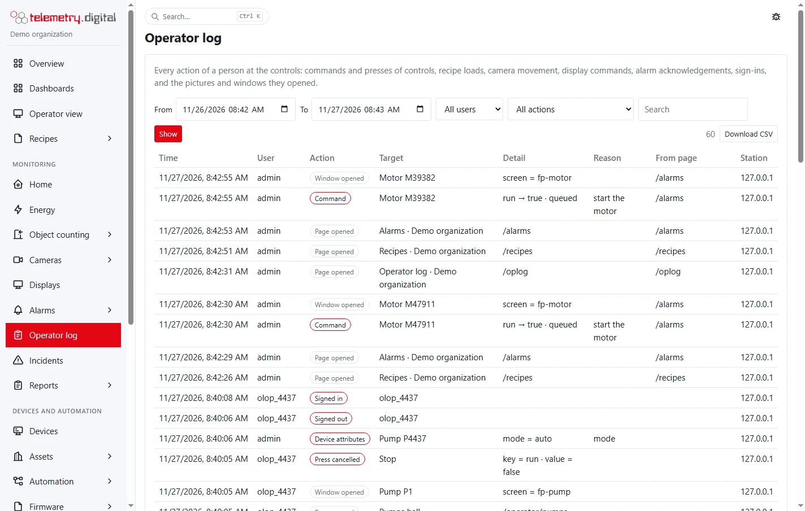

The **operator log** (0.93.0) is the diary of the people at the controls: who pressed what, where and when. It is
switched off until you switch it on for your organization.

## Switching it on

*Settings → Security policy* → **Operator log: record every action of the people at the controls**, give a reason and
save. You need the permission `user.admin`. The change is written to the audit trail.

| Option | Default | Effect |
|---|:---:|---|
| Operator log | off | when on, every action listed below is recorded; when off, nothing is written and the rows already recorded stay |

!!! note "Tell your people"
    The log records the work of named persons, including which pages they open. Inform them before you switch it on,
    as your rules on personal data require.

## What is recorded

| Action | When |
|---|---|
| Command; Command approved; Command rejected | a set point, switch, button, knob or slider, an element of a process picture, a command on the device page, a scene, the API |
| Recipe load; approved; rejected | a [recipe](../dashboards/recipes.md) record loaded into a unit |
| Device attributes | shared attributes of a device changed |
| Alarm acknowledged; Alarm shelved; Alarm shelf ended | on the Alarms page, in the alarm line, in a widget |
| Camera movement | every PTZ move, stop and preset |
| Recording viewed; Recording exported; Recording held as evidence; Evidence hold released; Evidence exported; Picture without masks; Camera mark | cameras and recordings |
| Display command; Kiosk PC command | displays at a wall and their computers |
| Scene; Flow test message; Occupancy corrected | a scene activated, a test message sent into a flow, the number of people in an area corrected |
| Signed in; Signed out | sign-in and sign-out of the application |
| Page opened; Window opened | every page and process picture a person opens, every faceplate and window |
| Press cancelled | a control was pressed and the confirmation was answered with Cancel |
| Signed in at the controls; Signed out at the controls; Sign-in at the controls refused; Control refused: not in its group; SCADA user changed | [SCADA users](scada-users.md): who signed in inside a picture, a wrong PIN, a control pressed by a person outside its groups |
| Second person asked for; Approved by a second person; Refused by a second person; Approval ended; Change held for approval; Change approved; Change rejected | [four eyes](four-eyes.md): an action was held, approved or refused, an approval for cameras or displays was asked for or ended |

Every row holds:

| Column | Meaning |
|---|---|
| Time | when it happened |
| User | the person signed in at the controls with the account of the computer in brackets, when [SCADA users](scada-users.md) are used; otherwise the signed-in user; for an API token or an AI assistant its name is added |
| Action | one of the actions above |
| Target | the device, camera, display, alarm, recipe or picture |
| Detail | what exactly: the key and the value of a command and its state, the preset of a camera, the address of a page |
| Reason | the reason the person gave |
| Page | the page of the application the action came from, for example `/operator/pumps` |
| Station | the network address of the computer |

The rows cannot be changed or deleted.

## Reading the log

Open *Operator log* in the menu, or `/oplog`. You need the permission `audit.read`.

| Control | Type | Default | Allowed values |
|---|---|:---:|---|
| From, To | date and time | the last 24 hours | any range |
| Users | list | All users | the users with actions in the range |
| Actions | list | All actions | *Actions only* (everything except pages and windows), *Pictures and windows only*, or one action |
| Search | text | — | up to 80 characters; searched in the target, the page, the reason and the detail |

**Show** applies the filters, **Older** loads the next 200 rows, **Download CSV** saves the range as a table.

When the log is switched off, the page says so and still shows the rows recorded before.

## Operator log and audit trail

| | Operator log | [Audit trail](audit.md) |
|---|---|---|
| Holds | what people did at the controls, also what changes nothing (pages, windows, every camera move) | every change of the system and its data, with old and new values |
| Switched on | by the organization | always |
| Protected by | rows that cannot be changed or deleted | the same, and a hash chain that proves it |
| Read with | `audit.read` | `audit.read` |

An action that changes something is in both.

## How long it is kept

*Settings → Security policy* → **Keep the operator log for (days, 0 = for good)**.

| Value | Effect |
|---|---|
| 0 (default) | every row is kept |
| 30 to 3650 | rows older than this are dropped once a day |

The rows still cannot be changed or deleted by anybody; the retention is the one exception, and it never drops
anything younger than 30 days. The [audit trail](audit.md) is not affected.
