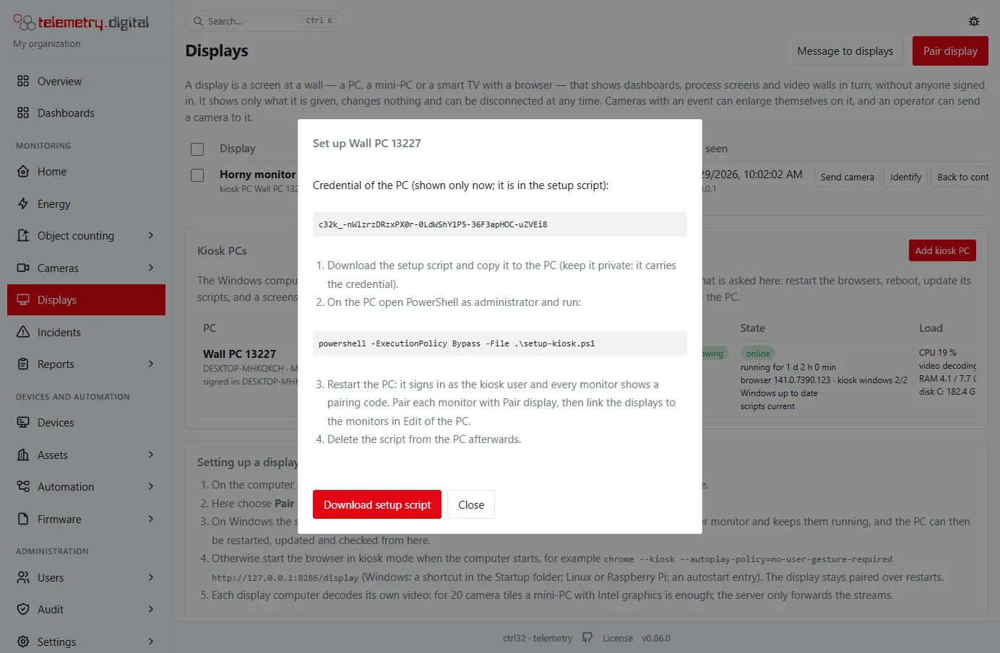
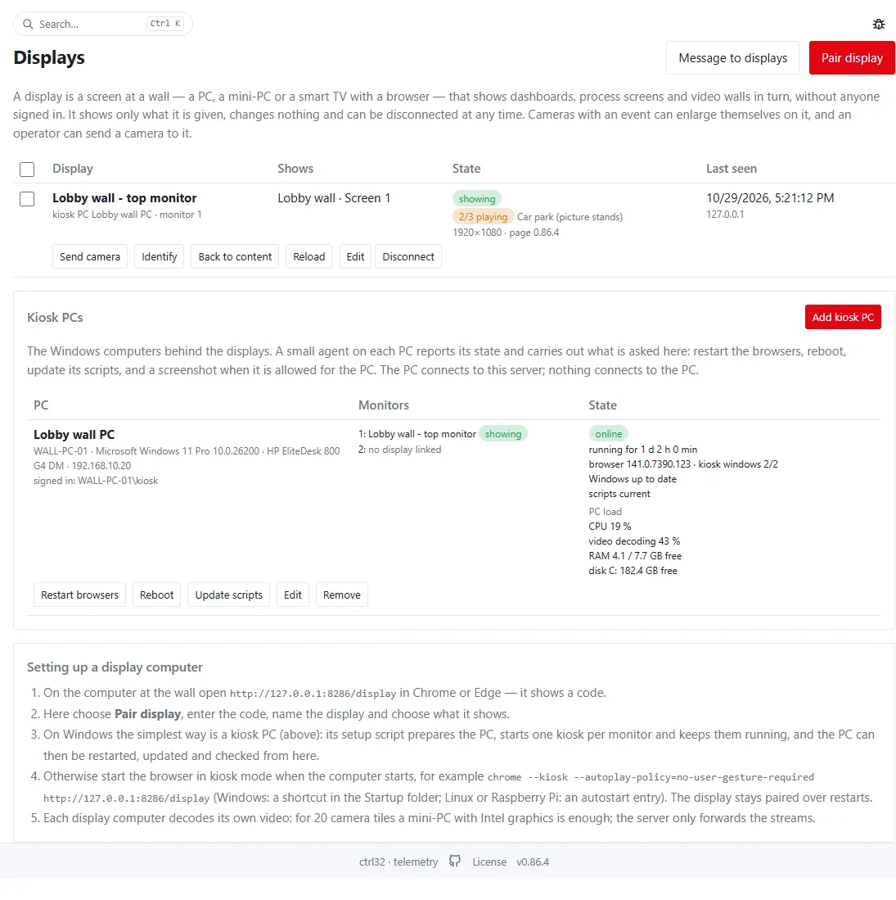
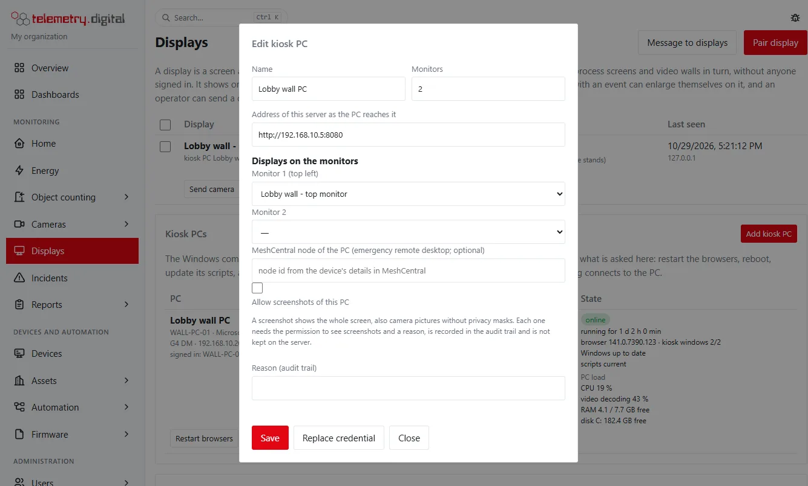

The everyday remote work happens **inside telemetry.digital**: the web interface and the API maintain the server —
updates of telemetry.digital and of the operating system, reboot, logs, health — and the Windows PCs behind the
displays (*kiosk PCs*). Every operation needs a permission and a reason and is written to the [audit trail](audit.md).
There is still no shell and no arbitrary command anywhere: the server agent and the kiosk agent perform closed lists of
operations.

**MeshCentral** (open source, self-hosted) stays as the **emergency path** — a remote desktop when something is broken
that these operations cannot fix. It is opened from the interface, every opening is audited with its reason, and
MeshCentral asks for its own sign-in with two factors.

## What is in telemetry.digital

| Task | Where | Permission |
|:---|:---|:---:|
| Update telemetry.digital (signed releases, backup first, rollback) | System → Updates | `system.admin` |
| Check and install the operating system updates, with the live log | System → Operating system | `system.admin` |
| Reboot the server (in one minute, can be cancelled) | System → Operating system | `system.admin` |
| Health: software RAID, network links, disks, reboot required | System → Server, Operating system | `system.admin` |
| Logs of the service, the agent, the proxy, the database, the VPN, the tunnel, the kernel | System → Logs | `system.admin` |
| Camera tiles playing on each display | Displays | `display.control` |
| Kiosk PCs: setup, state, restart the browsers, reboot, update the scripts | Displays → Kiosk PCs | `display.manage` |
| Screenshot of a kiosk PC (off until allowed for the PC) | Displays → Kiosk PCs | `display.screenshot` |
| Emergency remote desktop of the server or a kiosk PC | System → Server, Displays | `system.admin`, `display.manage` |

The operating system pages need a Linux server with apt (Debian, Ubuntu); on Windows they say so — install the Windows
updates with Windows Update. Details of the server pages: [Server, backups and updates](server.md#operating-system).

## Kiosk PCs

A kiosk PC is the Windows 10/11 computer behind one or more displays: one Chrome kiosk per monitor, each paired as its
own display.

1. **Displays → Kiosk PCs → Add kiosk PC**: the name, the number of monitors and the address of the server as the PC
   reaches it (in a local network often the local address, for example `http://10.0.0.5:8080`). The credential of the
   PC is shown once; it is inside the setup script.
2. **Download setup script** and run it on the PC in an elevated PowerShell:
   `powershell -ExecutionPolicy Bypass -File .\setup-kiosk-<name>.ps1`. Parameters: `-KioskUser` (default `kiosk`),
   `-ResetPassword`, `-ProfileDir` to keep the browser profiles of an older setup (so its displays stay paired) and
   `-ReplaceTask` to switch an older launcher off.
3. Restart the PC: it signs in as the kiosk user and each monitor shows a pairing code. Pair each monitor with **Pair
   display**, then link the displays to the monitors under **Edit** of the PC. Delete the script afterwards.

The setup script prepares the PC: a standard kiosk user with automatic logon (its password is generated on the PC and
never sent anywhere), power settings that never sleep, no lock screen, notifications or tips, Windows Update installing
and restarting at 03:00, and browser policies for unattended video. It installs two readable PowerShell scripts:

- **the launcher** (at the kiosk user's logon): one Chrome kiosk per monitor with its own profile (the top left
  monitor first), started again within 30 seconds when it closes; the taskbar stays hidden;
- **the agent** (a SYSTEM task): every 15 seconds it reports the PC and performs what was asked on the Displays page —
  *report now*, *restart the browsers*, *reboot*, *update the scripts*, *screenshot*. Nothing else; it never runs text
  from the server. Only SYSTEM and administrators can change the scripts or read the credential.

The PC connects to the server; nothing connects to the PC.

| Column | Content |
|:---|:---|
| PC | the name, the computer name, Windows, model and address, the signed-in user |
| Monitors | the display on each monitor and whether it shows |
| State | online or since when offline, running time, the browser and its kiosk windows, pending Windows updates, a pending restart, whether the scripts are current, the operation in progress and the last result |
| PC load | processor, video decoding, memory and disk |

**Edit** sets the name, the monitors, the server address, the displays on the monitors (a display started by the
launcher suggests its PC and monitor), the MeshCentral node and whether screenshots are allowed. **Replace credential**
stops the old credential at once; the PC reports again after its setup script ran with the new one. **Remove** locks
the agent out; the displays stay paired.

### Screenshots

A screenshot shows the whole screen, also camera pictures without privacy masks. It is therefore off for every PC
until an administrator with `display.screenshot` allows it for that PC with a reason. Each screenshot needs
`display.screenshot` and a reason and is in the audit trail; the picture goes from the PC to the server's memory and
is handed once to the person who asked for it — it is never stored.

## Emergency remote desktop (MeshCentral)

**System → Server → Remote management**: the MeshCentral address and the node of this server (from the device's
details in MeshCentral, or `gotonode=` in its address bar). A kiosk PC has its own node (**Edit** of the PC).
**Emergency remote desktop** asks for a reason and opens the device in MeshCentral in a new tab.

MeshCentral is still needed for a server or PC that does not start its services, for network repair on the machine
itself, for BIOS or hardware questions, for installing on a new PC remotely, and for anything outside the operations
above.

### Adding a PC to MeshCentral

1. MeshCentral → *My Devices* → *Add Device Group* (for example the customer's name), type *Manage using a software
   agent*.
2. *Add Agent* → Windows or Linux → download the installer and run it on the PC as administrator → *Install*.
3. The PC appears in the group. Copy its node id into telemetry.digital (server or kiosk PC). Set the group's *User
   Consent* if the customer wants to confirm every remote session.

### Security

- MeshCentral: only accounts created by an administrator, two-factor sign-in, 10 failed sign-ins in 10 minutes lock the
  address for 30 minutes; every session is in its event log.
- telemetry.digital: opening the remote desktop is audited with the reason; the link carries no credential.
- Remove a PC from its group when the contract ends; the agent then has no access.
