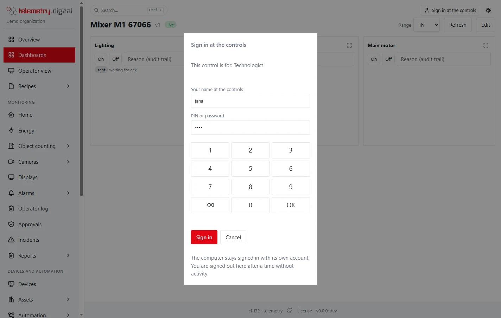
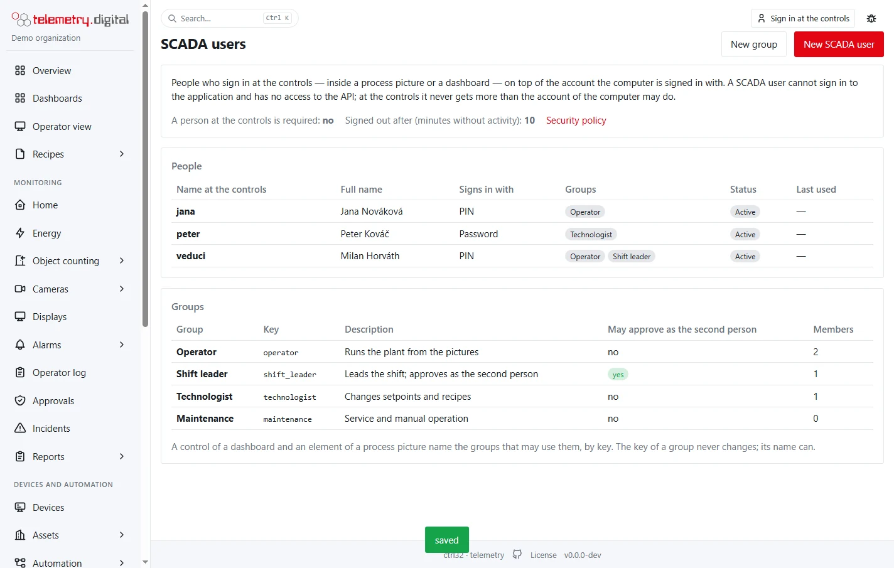
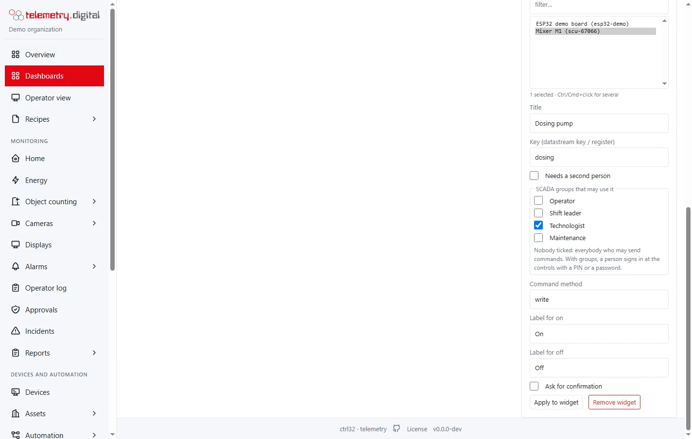
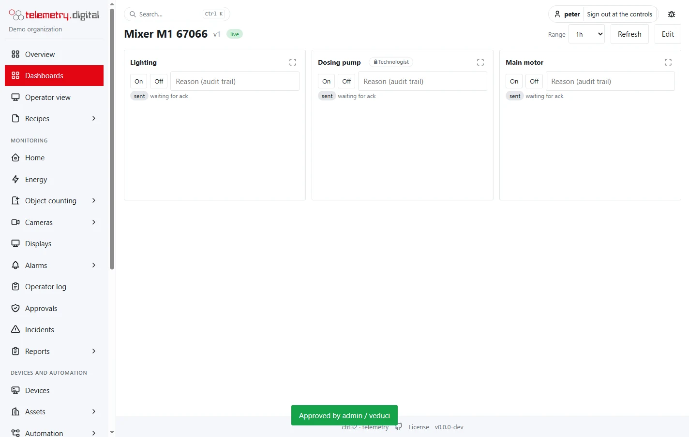
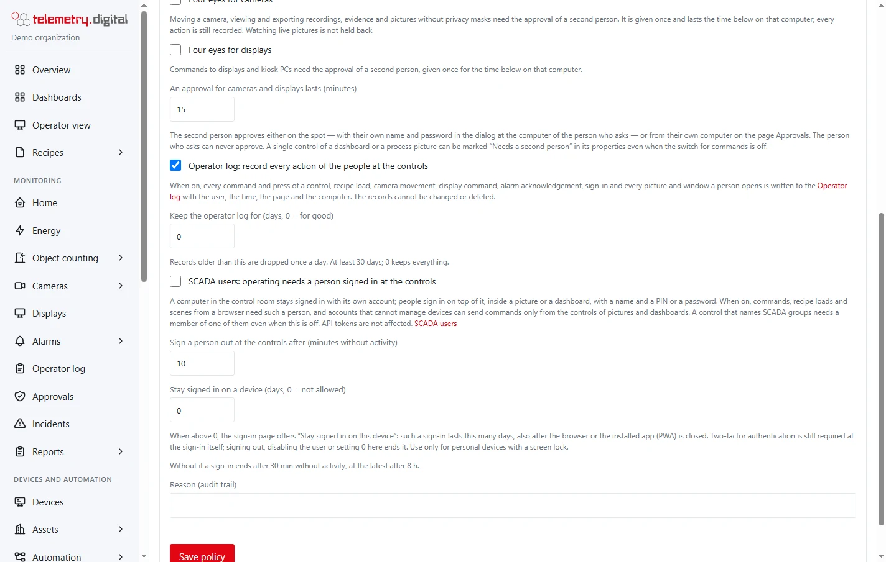
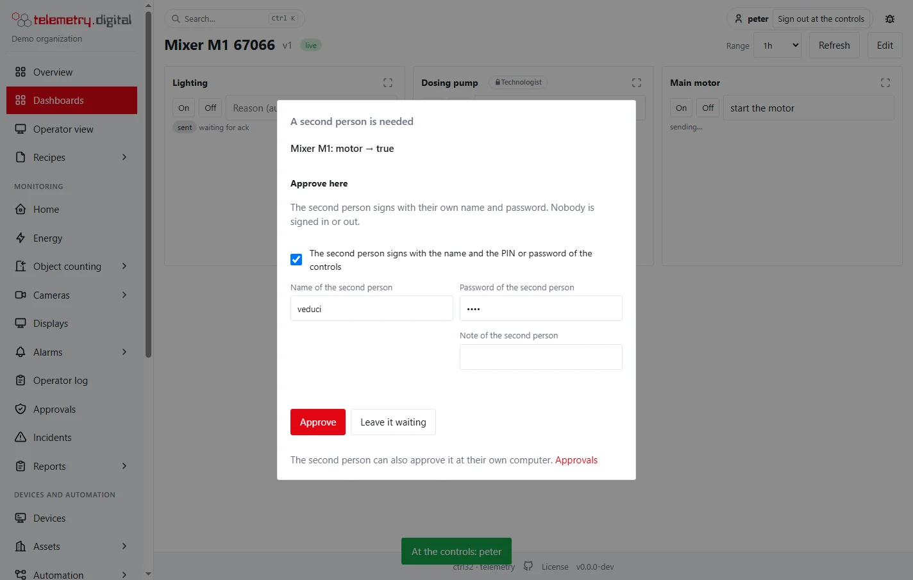
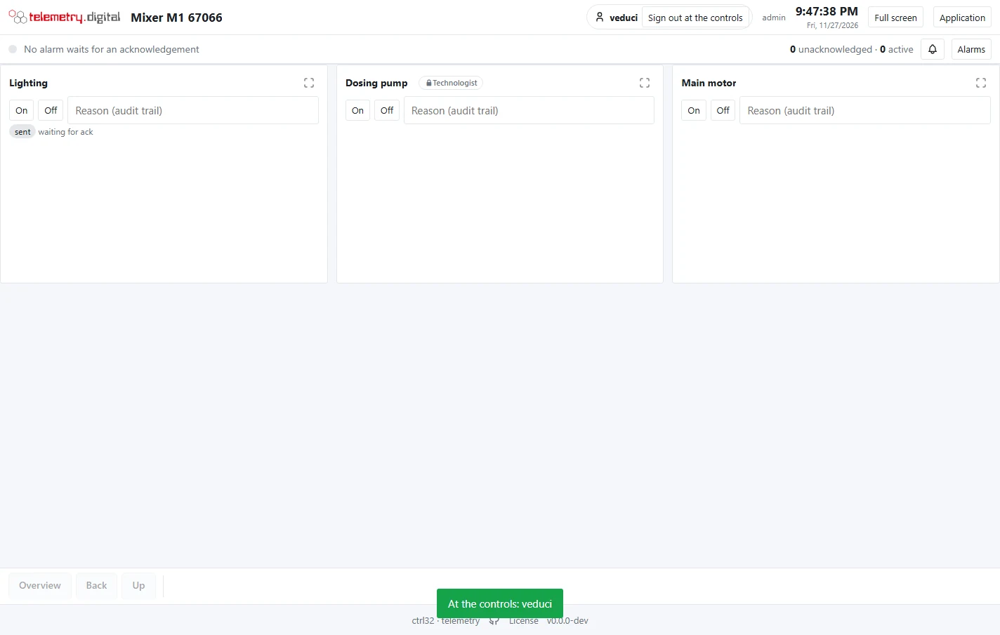

A **SCADA user** is a person who signs in **at the controls** — inside a process picture or a dashboard — on top of
the account the computer is signed in with. It is the second level of identity known from WinCC: the computer of the
control room stays signed in all shift, and the records still say *who* pressed the button.

| | Account (user) | SCADA user |
|---|---|---|
| Signs in | on the sign-in page | inside a picture or a dashboard, on top of an account |
| Secret | password, two-factor sign-in | a PIN or a password, as the administrator chooses per person |
| Rights | roles and permissions | groups; never more than the account of the computer may do |
| Application and API | yes | no |
| Managed in | *Users → Accounts* | *Users → SCADA users* |

Nothing changes at the controls until you create SCADA users or switch the requirement on.

## People and groups

*Users → SCADA users* (`/users/scada`). You need the permission `user.admin`; every change asks for a reason and is
written to the audit trail.

### A SCADA user

| Field | Required | Limits | Notes |
|---|:---:|---|---|
| Name at the controls | yes | 1–32 characters: small letters, digits, `.` `-` `_` | what the person types; cannot be changed later |
| Full name | no | at most 100 characters | |
| Signs in with | yes | PIN or Password | chosen per person |
| PIN | yes | 4–12 digits | |
| Password | yes | at least 8 characters | |
| Groups | no | | a person without a group can use only controls that name no group |
| May sign in at the controls | | on by default | switching it off signs the person out at once |

- Five wrong PINs or passwords in a row lock the SCADA user for 15 minutes (the thresholds of the security policy for
  accounts). **Unlock** ends the lock.
- A new PIN or password signs the person out everywhere.
- **Remove** deletes the SCADA user; commands, the audit trail and the operator log keep the name.
- At most 500 SCADA users in an organization.

### Groups

Every organization starts with four groups. Rename them, add your own (at most 32) or remove them.

| Group | Key | May approve as the second person |
|---|---|:---:|
| Operator | `operator` | no |
| Shift leader | `shift_leader` | yes |
| Technologist | `technologist` | no |
| Maintenance | `maintenance` | no |

| Field | Notes |
|---|---|
| Name | 1–60 characters; can be changed any time |
| Key (for controls) | small letters, digits and `_`, at most 32 characters; made from the name when left empty; **never changes** — controls name groups by key |
| Description | at most 200 characters |
| Its members may approve as the second person | see [Four eyes](four-eyes.md) |

!!! warning "Removing a group"
    A control that names a removed group is closed to everybody until you edit the control.

## Which control is for whom

A control of a dashboard — *Setpoint*, *Switch*, *Button*, *Knob*, *Slider*, *Round switch* — and an element of a
process picture with a device for operation have the property **SCADA groups that may use it**.

| Groups ticked | Who can use the control |
|---|---|
| none (default) | everybody whose account may send commands |
| one or more | a person signed in at the controls who is a member of at least one of them |

A control with groups shows them next to its title.

The **server** checks it. The command names the control it came from; the server reads the groups — and the mark
*Needs a second person* — from the stored dashboard. The account of the computer still needs the permission
`device.command`: a SCADA user never gets more than the computer may do.

## Signing in at the controls

- Press a control that needs somebody, or **Sign in at the controls** above the page (in the header on a phone, in the
  frame of the [operator view](../dashboards/operator-view.md)).
- A dashboard can carry the widget [Person at the controls](../dashboards/widgets-controls.md#person-at-the-controls)
  with large buttons for a touch panel.
- Type your name and your PIN or password. The PIN pad is for touch screens; names used at this computer before are
  offered as buttons.
- The computer stays signed in with its own account. Signing in replaces the person who was at the controls.
- When your group may not use the control, the dialog says for whom the control is, and somebody of that group can
  sign in.

You are signed out:

| When | |
|---|---|
| **Sign out at the controls** | at once |
| no activity at the computer | after the minutes of the policy (10 by default) |
| somebody else signs in at this computer | at once |
| the computer's account signs out | at once |

Another browser session of the same account — another computer, or a private window — is another station: nobody is
signed in there.

## Requiring a person at the controls

*Settings → Security policy* (`user.admin`, a reason, audited).

| Option | Default | Limits | Effect |
|---|:---:|---|---|
| SCADA users: operating needs a person signed in at the controls | off | | see the table below |
| Sign a person out at the controls after (minutes without activity) | 10 | 1 to 480 | |
| Keep the operator log for (days, 0 = for good) | 0 | 0, or 30 to 3650 | see [Operator log](operator-log.md) |

What needs a SCADA user:

| | Requirement off | Requirement on |
|---|---|---|
| A control that names groups | a member of one of the groups | a member of one of the groups |
| A control without groups | nobody | anybody signed in at the controls |
| Loading a recipe, activating a scene | nobody | anybody signed in at the controls |
| A command from the device page | nobody | only accounts with `device.manage`, under their own name |
| Acknowledging and shelving alarms | nobody | nobody (the SCADA user is recorded when one is signed in) |
| API tokens, AI assistants | never | never; they cannot use a control that names groups |

!!! note "Make the groups binding"
    With the requirement off, a person who knows the account of the computer can send a command from the device page,
    where no control and so no group is involved. Switch the requirement on to close that way: accounts that cannot
    manage devices then send commands only from the controls of pictures and dashboards.

## The second person with a PIN

In the dialog **A second person is needed** of [Four eyes](four-eyes.md), tick *The second person signs with the name
and the PIN or password of the controls*.

| Condition | Otherwise |
|---|---|
| the second person is a member of a group that may approve | refused |
| the request was made by a person signed in at the controls | an account has to approve it |
| the second person is somebody else than the one who asked | refused |

The approval runs with the rights of the computer's account and is recorded as *account / person*.

## What is recorded

| Where | What |
|---|---|
| Command log of the device | *issued by* account / person, *approved by* |
| [Audit trail](audit.md) | the actor is *account / person*; every change of SCADA users and groups, never a PIN or a password |
| Access log | every check of a PIN or a password, successful or not |
| [Operator log](operator-log.md), when on | the person in every row, and *Signed in at the controls*, *Signed out at the controls*, *Sign-in at the controls refused*, *Control refused: not in its group*, *SCADA user changed* |
| *Approvals* | who asked: account / person |

## Limits

- The server checks that the key of a command belongs to the control it names. It does not check the device: faceplate
  types bind their devices when the picture is drawn.
- The four default groups are shown in your language until you rename them; your own names are shown as you typed
  them.
- A PIN is weaker than a password. It works only at the controls, never for the application or the API, wrong PINs
  lock the person, and every use is recorded. Choose passwords for people who may approve.
