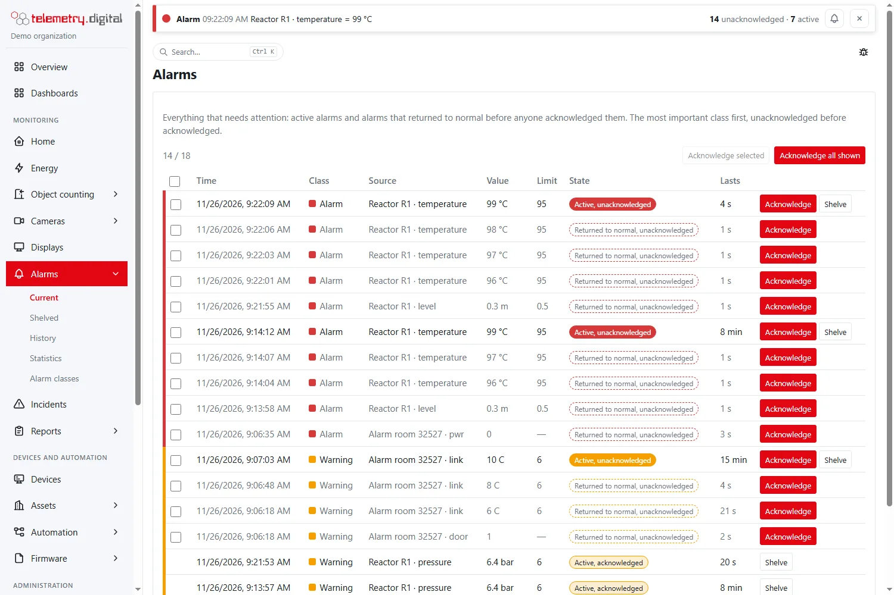
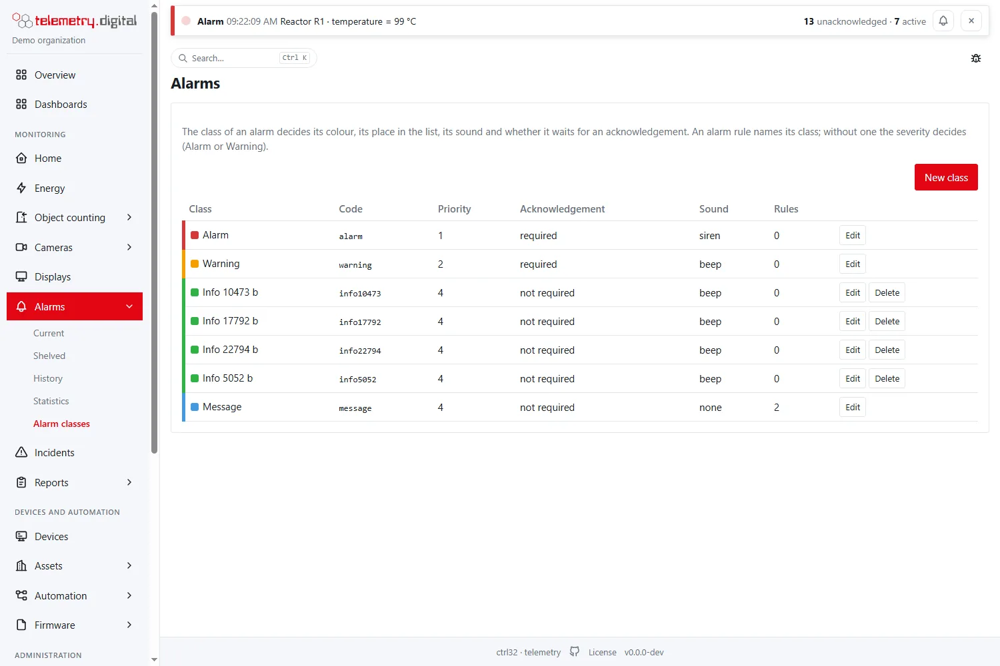
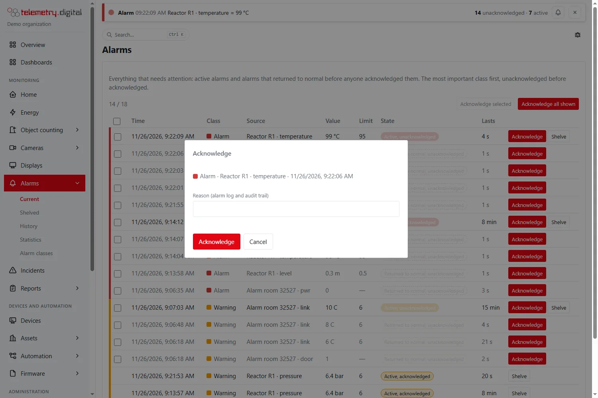
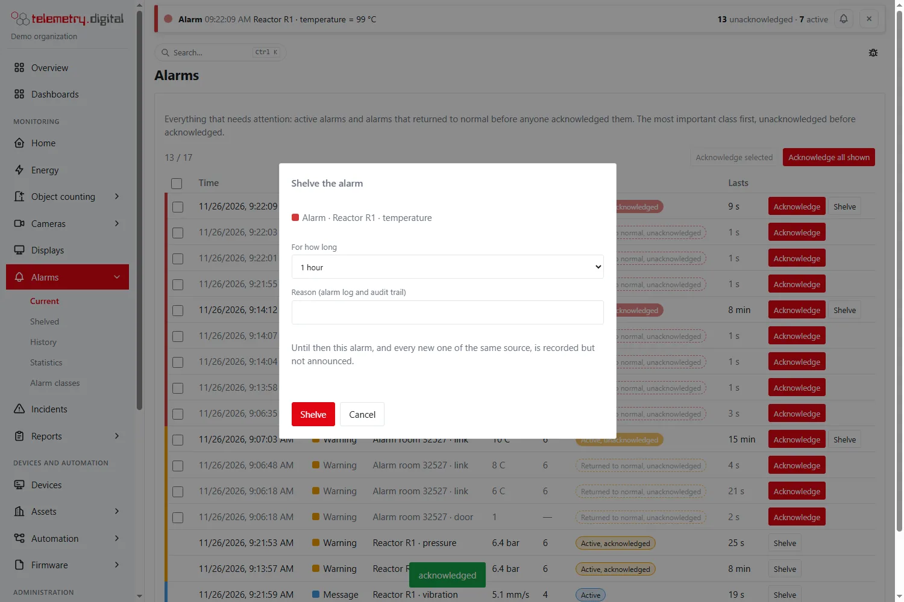
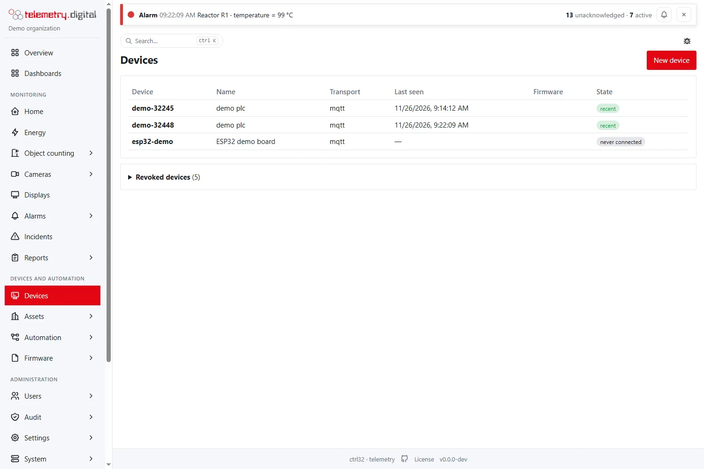
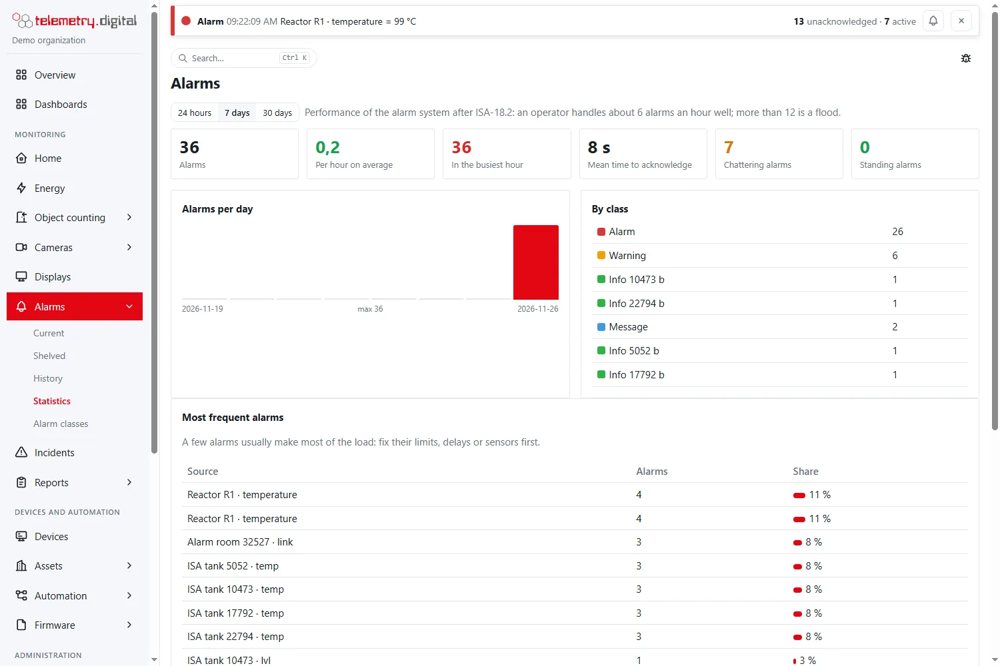

From 0.89.0 the alarm system follows **ANSI/ISA-18.2** (IEC 62682), the standard for alarm management in process
plants: every alarm has a class, an alarm that came and went stays on the screen until someone acknowledges it, a
nuisance alarm can be shelved, an alarm bar on every page shows what waits, and statistics tell which alarms load the
operators. [Alarm rules](alarms.md) and [notifications](notifications.md) work as before.

## Alarm states

The condition and the acknowledgement are two independent facts, so an alarm has one of five states:

| State | Condition | Acknowledged | How it is shown |
|---|---|---|---|
| **Active, unacknowledged** | active | no | filled in the class colour, blinking |
| **Active, acknowledged** | active | yes | pale class colour, steady |
| **Returned to normal, unacknowledged** | back in range | no | dashed outline, blinking — it happened and nobody confirmed it |
| **Normal** | back in range | yes | history only |
| **Shelved** | active | — | in the *Shelved* list only, not announced |

An alarm that returned to normal can be acknowledged (before 0.89.0 it disappeared from the screen by itself). In
the API every alarm carries `isa_state` (`unack_active`, `ack_active`, `unack_rtn`, `normal`, `shelved`); the earlier
`state` (`active`, `acknowledged`, `suppressed`, `cleared`) stays for existing clients.

Alarms that had cleared before the upgrade to 0.89.0 count as acknowledged.

## Alarm classes

The class of an alarm decides its **colour**, its **place in the list**, its **sound** and whether it **waits for an
acknowledgement**. Every organization has three built-in classes:

| Class | Priority | Colour | Acknowledgement | Sound |
|---|---|---|---|---|
| **Alarm** | 1 (highest) | red | required | siren |
| **Warning** | 2 | amber | required | beep |
| **Message** | 4 | blue | not required | none |

- An [alarm rule](alarms.md) names its class (`class_id`); without one the severity decides: `action` and `critical`
  → *Alarm*, `warning` → *Warning*. Alarms of automation rules take the class of their severity.
- *Alarms → Alarm classes* (permission `config.write`, each change with a reason, audited): add your own classes
  (code, name, priority 1–4, colour, acknowledgement, sound) and change the built-in ones. ISA-18.2 recommends three
  or four priorities, most alarms in the lowest.
- An alarm of a class **without acknowledgement** never waits for anyone: it shows while it is active and goes to the
  history when it returns to normal. Use it for operating messages.
- A class used by alarm rules and the built-in classes cannot be deleted.

## The Alarms page

*Monitoring → Alarms* (permission `data.read`):

| Tab | What it shows |
|---|---|
| **Current** | everything that needs attention: active alarms and alarms that returned to normal unacknowledged. The most important class first, unacknowledged before acknowledged, newest first. Refreshes every 5 seconds. |
| **Shelved** | shelved alarms with who shelved them, why and until when |
| **History** | the alarms raised in any range, by class and by text in the source; *Download CSV* |
| **Statistics** | the performance of the alarm system — see below |
| **Alarm classes** | the classes |

Each row shows the time, the class, the source (asset · datastream, or the automation rule), the value and the limit
crossed, the state and how long the alarm lasts.

### Acknowledging

With `alarm.ack`: **Acknowledge** in a row, **Acknowledge selected** (tick the rows) or **Acknowledge all shown** —
up to 500 alarms with one reason. The reason (at least 3 characters; three common ones are offered) goes to the alarm
log and the audit trail of every alarm. Acknowledging stops the escalation of the alarm.

### Shelving

A sensor is being replaced, a pump is in maintenance: the alarm is known and must not disturb. **Shelve** (permission
`alarm.ack`) puts the alarm aside for **15 minutes to 24 hours** with a reason:

- the alarm, and **every new alarm of the same source** until then, is recorded in the alarm log but **not
  announced**: not in the alarm bar, no sound, no notification, no escalation;
- the shelf **ends by itself**; *Unshelve* ends it earlier (with a reason). Alarms still active then return to the
  current list, unacknowledged ones are announced again;
- shelving and its end are events of the alarm log (`suppressed`, `unsuppressed`) and audit entries
  (`alarm.suppress`, `alarm.unsuppress`);
- a new version of the alarm rule is not shelved.

## The alarm bar

Every page with the menu shows, for people with `data.read`, a bar under the top of the page while an alarm is active
or waits for an acknowledgement: the **most important unacknowledged alarm** (class, time, source, value; a blinking
dot in the class colour), the numbers of **unacknowledged** and **active** alarms and a link to the Alarms page.

- **Sound**: the bell button switches the class sound on for this browser (browsers allow sound only after a click).
  The sound repeats every 5 seconds until the alarm is acknowledged or shelved.
- **×** hides the bar until another alarm becomes the most important one.
- Shelved alarms are not shown. Public links and paired displays have no bar in this version.

## Statistics

ISA-18.2 measures an alarm system by the load it puts on the operator. *Alarms → Statistics* shows, for the last 24
hours, 7 days or 30 days:

| Number | Meaning | Guide |
|---|---|---|
| Alarms | alarms raised in the range | |
| Per hour on average | | up to about **6** is manageable (green), more than **12** is a flood (red) |
| In the busiest hour | the peak | same colours |
| Mean time to acknowledge | from raising to the acknowledgement by a person | |
| Chattering alarms | sources with three or more alarms within a minute | add hysteresis or a delay to the rule |
| Standing alarms | active for longer than 24 hours now | fix the cause or the limit — an alarm nobody acts on is not an alarm |

Below: alarms per day, the counts by class, and the **ten most frequent alarms** with their share — a few alarms
usually make most of the load, so their limits, delays and sensors are where to start. Shelved alarms are left out of
the load numbers.

## API

| Call | Permission | |
|---|---|---|
| `GET /api/v1/alarms?view=current\|shelved\|history` | `data.read` | lists; history takes `from`, `to`, `class`, `q` |
| `GET /api/v1/alarms/summary` | `data.read` | counts and the top alarm (what the alarm bar shows) |
| `GET /api/v1/alarms/stats?from&to&tz` | `data.read` | the statistics (at most 92 days) |
| `POST /api/v1/alarms/{id}/ack` | `alarm.ack` | `{"reason"}`; 404 when already acknowledged |
| `POST /api/v1/alarms/ack` | `alarm.ack` | `{"ids": […], "reason"}`, up to 500 |
| `POST /api/v1/alarms/{id}/shelve` | `alarm.ack` | `{"minutes": 15…1440, "reason"}`; 409 when already shelved |
| `POST /api/v1/alarms/{id}/unshelve` | `alarm.ack` | `{"reason"}` |
| `GET\|POST /api/v1/alarm-classes`, `PUT\|DELETE /api/v1/alarm-classes/{id}` | `data.read` / `config.write` | the classes |

## Not in this version

Suppression by design (an alarm hidden by a plant state), taking an alarm out of service with a permit, alarm groups
with a collective indicator in process pictures, and the alarm bar on paired displays.
