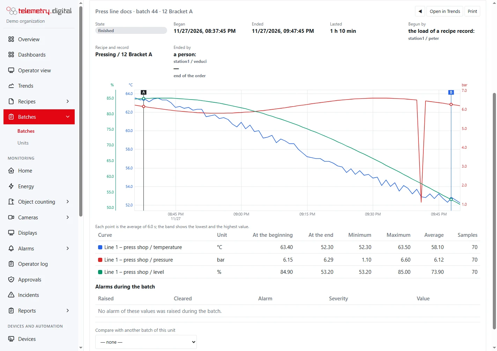
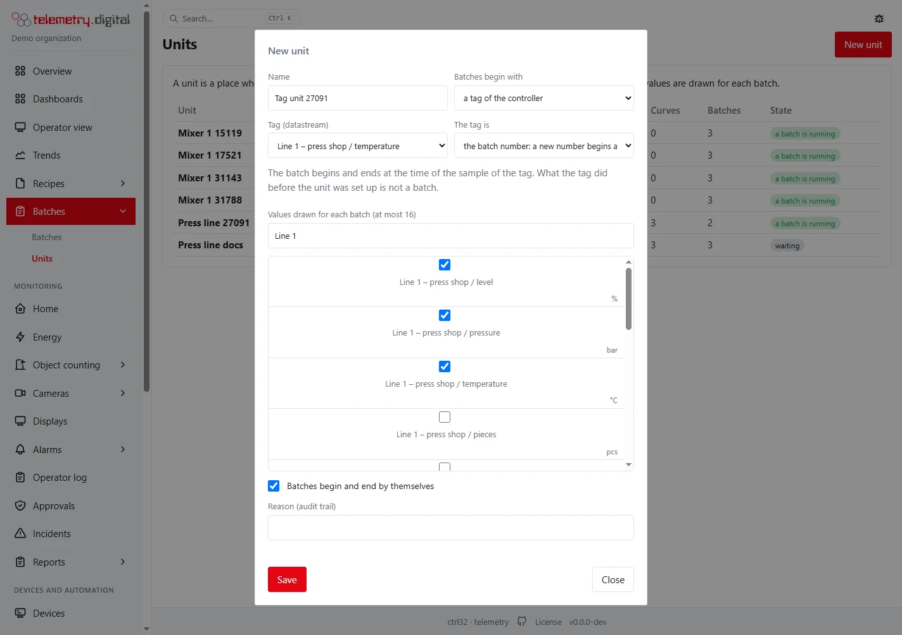
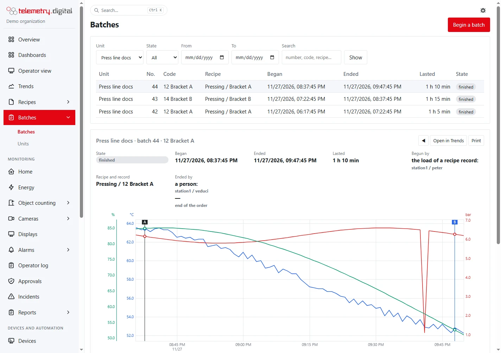
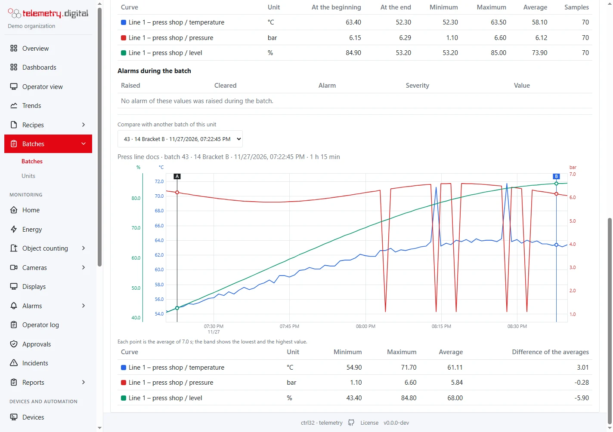
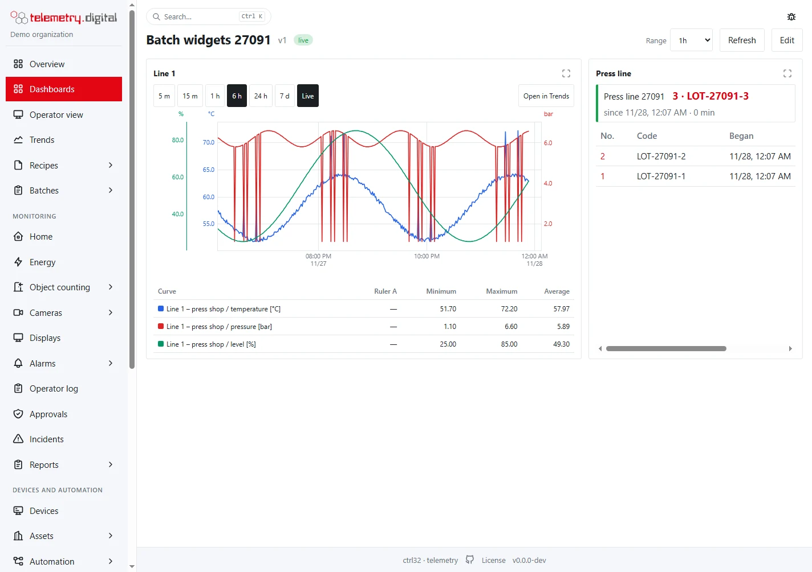

The **batch record** (0.97.0) says when a batch ran on a unit, what was loaded for it, who began and ended it, and
how its values went — the trend of the batch, the statistics of its curves and the alarms raised during it.

Open **Batches** in the menu (`/batches`). Reading needs the permission `data.read`.

## Units

A **unit** is a place where batches run — a mixer, a reactor, a line. *Batches → Units*; changing units needs
`device.manage`, a reason, and is written to the audit trail.

| Field | Required | Notes |
|---|:---:|---|
| Name | yes | 1–80 characters, unique |
| Batches begin with | yes | *the load of a recipe record* or *a tag of the controller* — see below |
| Device of the unit, Key prefix of the unit | for recipe loads | the same device and prefix as the unit of the [recipe](recipes.md) |
| Tag (datastream), The tag is | for a tag | see below |
| Values drawn for each batch | no | at most 16 datastreams: the trend and the statistics of every batch |
| Batches begin and end by themselves | | on by default; off: only a person begins and ends them |

At most 200 units. Removing a unit ends its running batch and takes it from the lists; its batches stay.

### Batches that begin with the load of a recipe record

| Event | Effect |
|---|---|
| a load into the device and prefix of the unit **finished** | the batch that ran ends; a new one begins and names the recipe, the record and who loaded it |
| *Check* only, a load that was refused, a load that failed | nothing |
| a load waiting for a second person | nothing until it is approved and finishes |
| the last batch of an order | a person presses **End the batch** |

### Batches that begin with a tag of the controller

| The tag is | Begins a batch | Ends it |
|---|---|---|
| a run bit | the value changes from zero to anything else | the value changes to zero |
| the batch number | the value changes to a new number that is not zero — the batch carries it as its code | the value changes (to zero: no batch runs) |

- A batch begins and ends **at the time of the sample**, not when the server noticed it. The server looks at the tags
  every 5 seconds.
- Samples of doubtful quality are skipped.
- A unit that was just set up, or whose tag was changed, starts watching from now: what the tag did before is not a
  batch.

## A batch

| | |
|---|---|
| Number | counted per unit: 1, 2, 3 … |
| Code | the number from the controller, the number and name of the recipe record, or what a person typed |
| One at a time | a batch that begins on a unit ends the one that ran |
| A record | a batch is never deleted; when it ends it keeps the curves of its unit and their statistics, so the record says the same after the unit is changed |

### By hand

With the permission `device.command`:

- **Begin a batch**: the unit, a code (lot, order — at most 60 characters) and a reason.
- **End the batch** in the record of a running batch: a reason.

Both are written to the [audit trail](../administration/audit.md) and, when on, to the
[operator log](../administration/operator-log.md). When the organization requires a person at the controls, a
[SCADA user](../administration/scada-users.md) must be signed in, and the record names that person.

## The list and the record

| Filter | |
|---|---|
| Unit | one unit or all |
| State | all, running, finished |
| From, To | batches that ran in that time (default the last 30 days); a running batch is always listed |
| Search | the number, the code, the recipe or the record |

A click on a row opens the record:

| Part | Content |
|---|---|
| Head | state, began, ended, lasted; begun by and ended by (a recipe load, a tag, a person — with the account and the person at the controls) and the reasons; the recipe and record |
| Trend | the curves of the unit over the batch, ruler **A** at its beginning and **B** at its end, the alarm limits; it moves and zooms like [Trends](trends.md) |
| Statistics | per curve: the value at the beginning and at the end, minimum, maximum, average, number of samples |
| Alarms during the batch | the alarms of those values raised while it ran |
| `◀` `▶` | the batch before and after it on the unit |
| **Open in Trends** | the same curves and time on the Trends page |
| **Print** | the record without the menu and the list |

A running batch is read again every 10 seconds.

## Comparing two batches

Choose **Compare with another batch of this unit**.

- The second batch is drawn under the first, both over the **same length of time** from their beginning — the longer
  of the two — so the shapes can be read against each other.
- The table shows the minimum, maximum and average of the second batch and the **difference of the averages** (second
  minus first).

## Widgets

Two widgets bring this to a dashboard, a process picture, the operator view and displays.

| Widget | Shows | Described in |
|---|---|---|
| Trend | the curves of the bound datastreams with dragging, zoom and a ruler | [Charts](widgets-charts.md#trend) |
| Batches | the batch that runs on a unit and the last batches | [Lists](widgets-lists.md#batches) |

## What is not there yet

- A signed batch report (PDF) and the e-signature of a batch.
- Phases and steps inside a batch, consumption of materials.
- The curves of two batches laid over each other in one chart.
