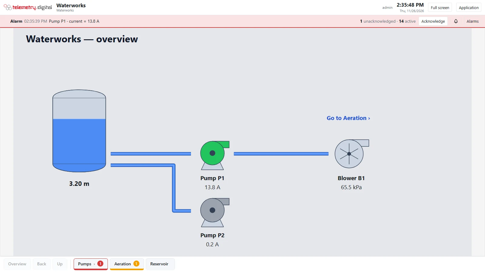
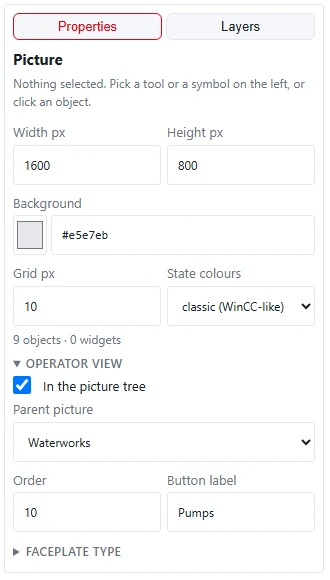
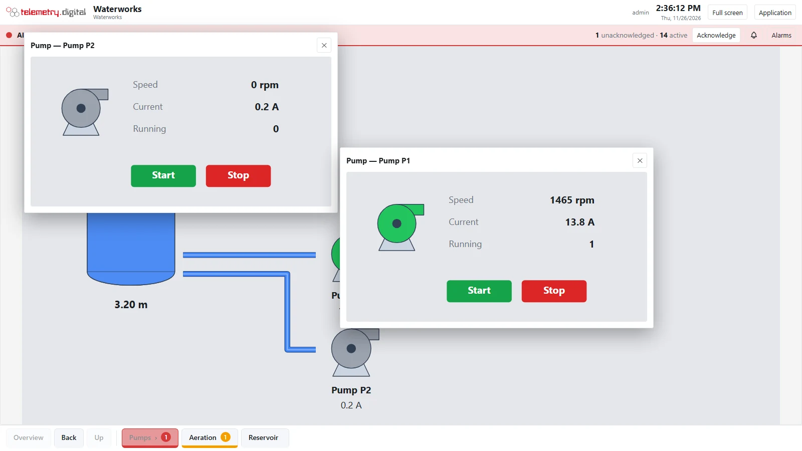
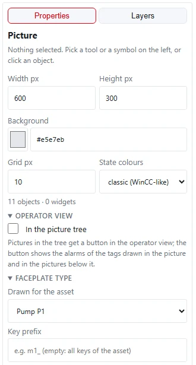

The **operator view** (0.90.0) shows process pictures the way a control-room station does: without the menu of the
application, in a fixed frame with an alarm line on top and navigation buttons below. The buttons follow the
**picture tree**, and each one shows whether an alarm waits in its part of the plant. A **faceplate type** is a small
picture drawn once — for one motor, pump or valve — and opened for every other one.

Open it with *Operator view* in the menu, or at `/operator`. It needs the permission `data.read`; acknowledging
needs `alarm.ack` and commands `device.command`, as everywhere else.

## The frame

| Part | What it shows |
|---|---|
| Header | the logo, the name of the picture and its path in the tree, the signed-in user, date and time, **Full screen**, and **Application** to go back to the menu |
| Alarm line | the most important alarm that waits for an acknowledgement, in the colour of its [alarm class](../automation/alarm-management.md) and blinking; the number of unacknowledged and active alarms; **Acknowledge**; the bell that switches the alarm sound on in this browser; **Alarms** opens the Alarms page |
| Work area | the picture, scaled to fit the width and the height of the screen, with live values |
| Button bar | **Overview**, **Back**, **Up** and one button for every picture below the current one |

- **Acknowledge** in the alarm line asks for a reason and acknowledges the alarm shown; the next one takes its
  place. Shelving, history and the other lists are on the [Alarms page](../automation/alarm-management.md).
- Changing the picture does not reload the page: the picture is swapped inside the frame, so the alarm line and the
  sound never pause. The address changes with the picture (`/operator/<screen>`), so the browser's Back and a
  bookmark work too.
- *Go to screen* actions of picture objects change the picture inside the frame as well.
- `/operator` starts with the organization's default screen when it is in the tree, otherwise with the first
  top-level picture. `/operator/<screen>` opens any screen, also one outside the tree.
- A dashboard with a grid layout can be in the tree too; it is shown with a scroll bar instead of being scaled.
- The application's own alarm bar and the update notice are not shown in the operator view.

The operator view is for a signed-in person. [Paired displays](displays.md) and public links show screens without a
user and therefore without the alarm line, navigation and commands.

## The picture tree

A screen is put into the tree in the editor: with nothing selected, the Properties panel shows *Operator view*.

| Setting | Type | Default | Allowed values |
|---|---|:---:|---|
| In the picture tree | switch | off | on gives the picture a button in the operator view |
| Parent picture | list | (top level) | another screen of the organization |
| Order | number | 0 | 0–9999; buttons of one parent are ordered by it, then by name |
| Button label | text | the name of the picture | at most 24 characters |

- The tree has at most **5 levels**. A parent that would make the picture its own ancestor is refused.
- The place in the tree is part of the screen, so changing it is a new version with a reason, like any other change.
- When a parent is deleted, its children move to the top level.
- Screens outside the tree stay reachable from the dashboard list, by *Go to screen* actions and as popups.

### Buttons

The button bar shows the pictures **below** the current one. A picture without children shows its siblings instead,
with itself marked, so the last level can be switched without going up first.

| Button | Does |
|---|---|
| Overview | the start picture |
| Back | the picture shown before (the browser's Back does the same) |
| Up | the parent picture |
| *picture* › | opens the picture; › tells that it has pictures below it |

## Group alarms

A button tells whether an alarm waits **in its picture or in any picture below it**:

| Button | Meaning |
|---|---|
| blinking in the class colour, with a number | alarms wait for an acknowledgement; the number counts them |
| steady coloured edge, with a number | all acknowledged, but still active; the number counts the active ones |
| plain | no alarm |

The alarms of a picture are the alarms on the **tags the picture uses**: the tags of its objects, the tags of their
dynamics and the datastreams of its widgets. Nothing has to be configured — drawing a tag into a picture puts its
alarms on the picture's button and on the buttons of all its parents.

- The colour is that of the most important alarm: an unacknowledged alarm before an acknowledged one, then by the
  priority of the [alarm class](../automation/alarm-management.md).
- [Shelved](../automation/alarm-management.md) alarms are not shown on buttons.
- Alarms of automation rules that are not tied to a datastream belong to no picture; they appear in the alarm line.
- Buttons and the alarm line are refreshed every 5 seconds.

## Faceplate types

Since 0.87.0 a click can open another screen as a popup — a small picture made as the window of a machine. Until
0.90.0 such a picture showed fixed tags, so ten motors needed ten pictures. A **faceplate type** is drawn once and
opened for any of them.

### Making a type

1. Draw a picture for **one real machine**: bind its objects to the datastreams of that asset, add the commands. You
   see live values while drawing.
2. With nothing selected, open *Faceplate type* in the Properties panel and choose the asset under **Drawn for the
   asset**.
3. Where the machines are not separate assets but groups of keys in one asset (`m1_speed`, `m2_speed`), also enter
   the **Key prefix** of the machine the type was drawn for (`m1_`).

| Setting | Type | Default | Allowed values |
|---|---|:---:|---|
| Drawn for the asset | list | (not a faceplate type) | an asset of the organization |
| Key prefix | text | empty: all keys of the asset | lower-case letters, digits and `_`, at most 32 characters |

### Opening it for a machine

Give the object of each machine the click action **Open screen as popup** with the faceplate type as its screen.

| Setting of the action | Default | Meaning |
|---|---|---|
| Asset | (asset of the object's tag) | the asset the faceplate is opened for |
| Key prefix | (of the type) | the key prefix of the machine, for example `m2_` |

With one asset per machine nothing more is needed: a pump symbol bound to any tag of *Pump P2* opens the faceplate
for *Pump P2*. With one asset for the whole PLC, enter the machine's key prefix.

### What is re-bound

When the type is opened for another asset or prefix, the server re-binds it **by datastream key**:

| In the type | In the opened window |
|---|---|
| a tag of the example asset whose key starts with the type's prefix | the datastream of the other asset with the key *prefix of the machine + rest of the key* |
| the same tag used by a dynamic or a widget | re-bound the same way |
| the device for operation and its commands | the device that delivers the re-bound datastreams; a command key that starts with the type's prefix gets the machine's prefix |
| a tag that has no counterpart | unbound: the object shows "—", its dynamics rest |
| tags of other assets, keys outside the prefix | unchanged — shared values such as a supply voltage |

!!! warning "Commands never fall back to the example"
    When the machine a faceplate is opened for has no device behind its datastreams, the commands of the faceplate
    are removed from that window. A faceplate opened for pump P2 can therefore never start pump P1, the pump it was
    drawn for.

### Windows

- The title is the name of the type and the asset (*Pump — Pump P2*), with the prefix when the action gives one.
- Windows can be **dragged** by their title. Up to **four** stay open; a fifth closes the oldest. Clicking the same
  machine again brings its window to the front instead of opening a second one.
- ✕ closes a window, **Esc** closes the one on top, and changing the picture in the operator view closes all.
- A window refreshes every 3 seconds. Commands ask for a reason and follow the same permissions, four-eyes rule and
  audit trail as everywhere.
- Windows work on the dashboard page and in the operator view, not on public links and paired displays.

## API

| Request | Permission | Returns |
|---|---|---|
| `GET /api/v1/screens/tree` | `data.read` | `home` and `nodes`: slug, name, label, kind, parent, order, depth, children, and the group state `unack`, `active`, `color`, `priority` |
| `GET /api/v1/dashboards/{slug}/instance?asset=&tag=&prefix=` | `data.read` | the spec of a faceplate type bound to an instance, and `instance` with the asset, the prefix and how many tags found a counterpart |

The place in the tree is `nav {parent, order, label}` and the type is `faceplate {asset, prefix}` in the spec of a
screen; the popup action accepts `asset` and `prefix`.

## Who is at the controls

When the organization uses [SCADA users](../administration/scada-users.md), the frame shows the person signed in at
the controls next to the account of the computer, with **Sign in at the controls** and **Sign out at the controls**.
