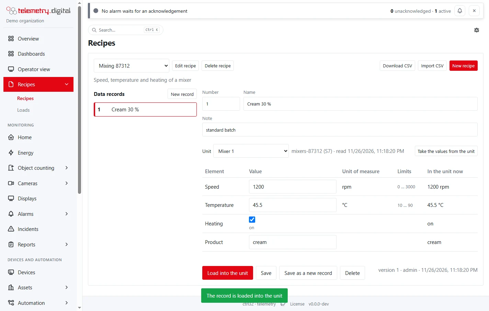
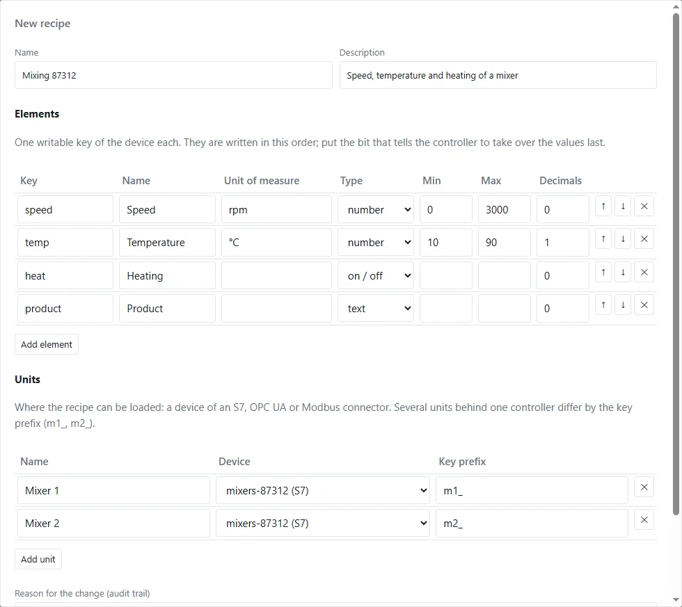
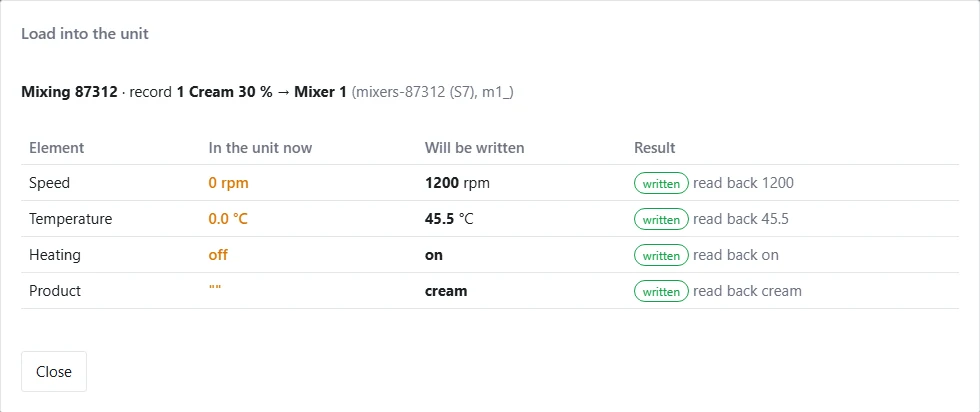
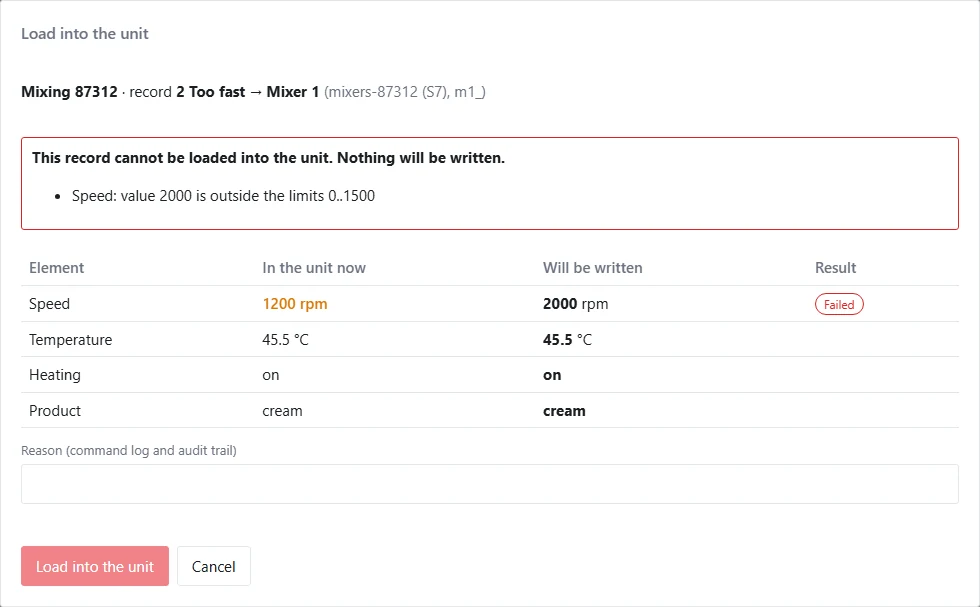
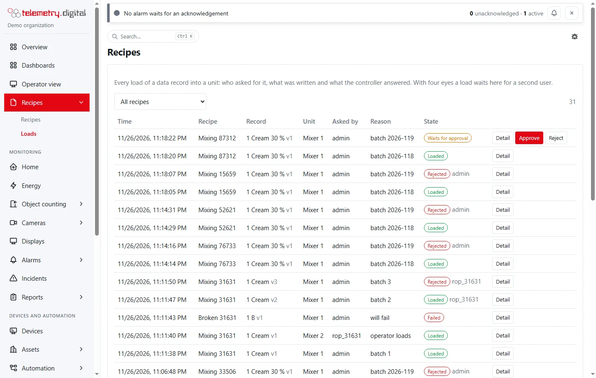
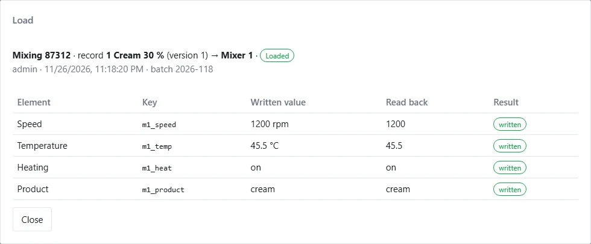
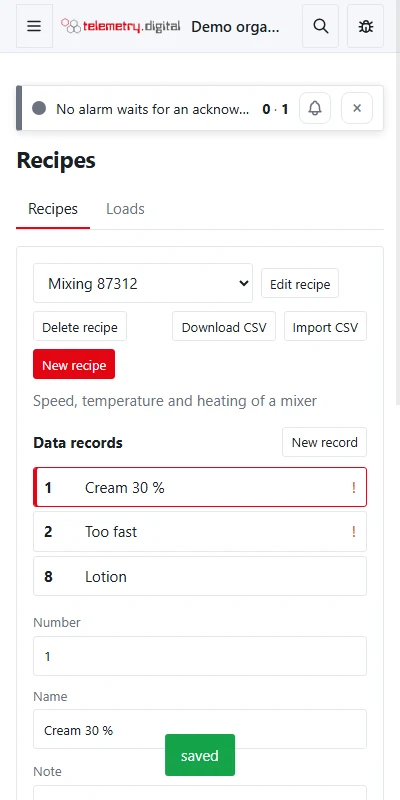

A **recipe** (0.92.0) holds the setpoints of a product as named **data records** and loads a record into a machine
with one action — instead of typing speed, temperature and times one by one. Every load is checked before the first
value is written, read back from the controller and kept in a log.

Open it with *Recipes* in the menu, or at `/recipes`.

| Term | Meaning |
|---|---|
| Recipe | a list of elements and the units it can be loaded into |
| Element | one value of the recipe: a writable key of a device, with its name, unit of measure, type and limits |
| Unit | where the recipe is loaded: a device of a connector, with an optional key prefix |
| Data record | a numbered, named set of values, one for every element — a product |
| Load | writing the values of a record into a unit |

## Permissions

| Action | Permission |
|---|---|
| See recipes, records, loads and the values in a unit | `data.read` |
| Create and change a recipe: its elements and units | `config.write` |
| Create, change, delete and import data records | `recipe.edit` |
| Load a record into a unit; approve or reject a load | `device.command` |
| Download the records as CSV | `data.export` |

The built-in role *operator* loads records and cannot change them; *engineer* and *org_admin* also have
`recipe.edit`. Give `recipe.edit` to the people who own the product data.

## Creating a recipe

**New recipe** opens the dialog. A recipe needs a name and at least one element; units can be added later.

### Elements

| Field | Type | Default | Allowed values |
|---|---|:---:|---|
| Key | text | — | `^[a-z][a-z0-9_]{0,31}$`; a **writable** key of the device, without the prefix of the unit. The writable keys of your connectors are offered |
| Name | text | the key | up to 80 characters; shown to the operator |
| Unit of measure | text | — | up to 16 characters |
| Type | list | number | number, on / off, text |
| Min, Max | number | — | numbers only; a record outside them cannot be saved |
| Decimals | number | 0 | 0–6, numbers only; values are rounded to them when a record is saved |

A recipe holds up to 200 elements. **They are written in the order of the list** — move them with the arrows.

!!! warning "Let the controller take the values over on one bit"
    A load writes the values one after another, so for a moment the controller holds a mix of two records. Program
    the PLC to copy the values into the running process only when a *take over* bit is set, and make that bit the
    **last element** of the recipe. If a load stops in the middle, the bit is never written and the process keeps the
    old values.

### Units

| Field | Type | Default | Allowed values |
|---|---|:---:|---|
| Name | text | — | up to 60 characters, for example `Mixer 1` |
| Device | list | — | a device of a [Siemens S7, OPC UA or Modbus connector](../devices/connectors.md) |
| Key prefix | text | — | `^[a-z][a-z0-9_]{0,15}$`, for example `m1_`; put before the key of every element |

Several machines behind one controller are several units with different prefixes: the element `speed` is written to
`m1_speed` in Mixer 1 and to `m2_speed` in Mixer 2. The [tag import](../devices/connectors.md#importing-tags-from-tia-portal-or-step-7)
creates keys with such a prefix. A recipe holds up to 50 units.

Every change of a recipe needs a reason and is written to the audit trail. **Delete recipe** removes it from the
list; its loads stay in the log.

## Data records

**New record** opens an empty form: give the record a name, fill in a value for every element and **Save**. The
number is the next free one unless you type another (1–99999). A recipe holds up to 1000 records.

- **Save** asks for a reason; the old and the new values go to the audit trail and the version of the record grows
  by one.
- **Save as a new record** keeps the opened record and stores the form as another one.
- A value outside the limits of its element, a missing value or text in a number field is refused with the name of
  the element.
- A record that no longer fits the recipe — an element was added, a limit was narrowed — is marked with **!** in the
  list. It cannot be loaded until you open it, correct it and save it.

### The values in the unit

Choose a **Unit** above the table. The column *In the unit now* shows the value of every element as the connector
last read it, and the line next to the unit says when. A value that differs from the form is highlighted.

| What you see | Meaning |
|---|---|
| a value | the last value the connector read from the controller |
| — | the connector does not read this key; add it to the connector's tags, nodes or registers |
| *No running connector reads this device.* | the connector is stopped or revoked |

**Take the values from the unit** fills the form with these values — tune a machine by hand, then keep the result as
a record. Nothing is stored until you save.

## Loading a record into a unit

**Load into the unit** opens a dialog with the record, the unit, and for every element the value in the unit now and
the value that will be written. Give a reason and confirm.

What happens, in this order:

1. **Everything is checked before the first write.** The connector checks every value as it checks a single command:
   the key exists, is writable, the type fits and the connector's own limits hold. If one value is refused, nothing
   is written and the dialog names it.
2. **The values are written in the order of the elements**, each one read back from the controller. Every write is a
   command in the [command log](../devices/commands-and-firmware.md) of the device, with the recipe, the record and
   your reason.
3. **The load stops at the first value the controller refuses.** The values after it are not written and are shown
   so.

- The limits of an element and the limits of the connector both apply. The stricter one wins.
- One load at a time runs into a device; a second one is refused until the first has finished.
- A load is finished even if you close the browser in the middle.
- An unsaved record cannot be loaded: save it first, so the log names the version that was written.

### Four eyes

With **four eyes for commands** switched on in *Settings → Security policy*, a load is not written at once. It waits
in *Loads* until **another user** with `device.command` approves it; the user who asked cannot approve their own
load. Anyone with `device.command` may reject it.

- The values are copied when the load is asked for. A change of the record while it waits does not change what will
  be written.
- At approval everything is checked against the connector again.
- A load nobody decides within 24 hours expires.

## Loads

*Recipes → Loads* lists every load, newest first: the time, the recipe, the record with its version, the unit, who
asked, the reason and the state.

| State | Meaning |
|---|---|
| Loaded | every value was written and read back |
| Failed | the controller refused a value; **Detail** shows which values were written and which were not |
| Waits for approval | four eyes: another user must approve or reject |
| Rejected | rejected, nothing was written |
| Expired | nobody decided within 24 hours, nothing was written |

**Detail** shows the values as they were written, the full key in the device, the value read back and the result of
every element.

## CSV

**Download CSV** saves the records of the recipe as a table: `number`, `name`, `note` and one column for every
element, named by its key. The file is UTF-8 and opens in a spreadsheet.

**Import CSV** reads the same table back, separated by commas or semicolons (with semicolons a decimal comma is
accepted). A record whose number exists is changed, a new number is added.

| Situation | What the import does |
|---|---|
| a column that is not an element of the recipe | refuses the file |
| the column of an element is missing | refuses the file |
| a value outside the limits, text in a number, the same number twice | refuses the file and names the line |

The import is all or nothing: one bad line and no record is changed.

## On a phone

The records are listed above the form, and the table of values scrolls sideways inside its frame.

## What is not there yet

- A batch record with the start and the end of a batch and the trends of its values.
- Loading a record from a button in a process picture or from a flow.
- Recipes for devices that are not behind an S7, OPC UA or Modbus connector.

## Batches

A unit of [Batches](batches.md) can follow the loads of a recipe: every load that finishes begins a batch, which
names the recipe, the record and who loaded it, and draws the trend of the unit for it.
