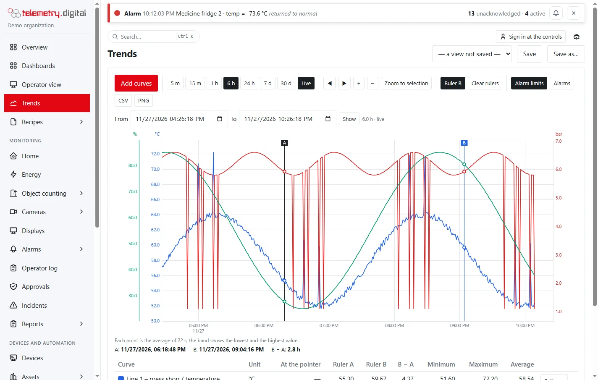
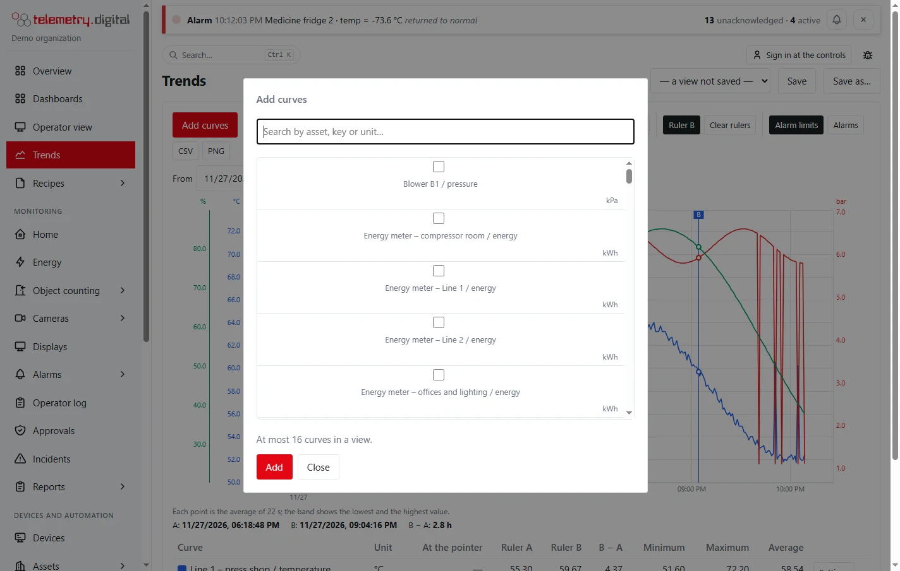
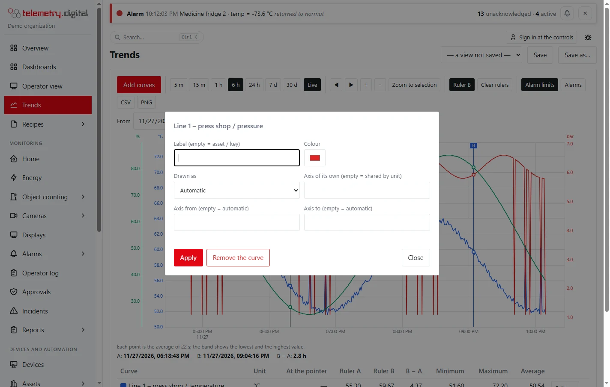

**Trends** (0.96.0) put any measured values on one time axis — now or for any time in the past — so that you can see
what happened together: zoom into ten minutes of last night, read the values at two moments and the difference
between them.

Open **Trends** in the menu (`/trends`). You need the permission `data.read`.

## Curves

**Add curves** lists the datastreams of your organization. Type to search by asset, key or unit, tick the ones you
want and press **Add**. A view holds at most 16 curves.

Each row of the table under the chart is a curve. A click on its colour hides or shows it; **Settings** opens:

| Field | Default | Notes |
|---|---|---|
| Label | asset / key | at most 80 characters |
| Colour | from the palette | |
| Drawn as | Automatic | *Line*, *Step line* or *Points*; Automatic draws states as steps and everything else as a line |
| Axis of its own | empty | empty: the curve shares the axis of its unit; a name gives it an axis of its own (at most 24 characters) — curves with the same name share that axis |
| Axis from, Axis to | automatic | a fixed range of the axis; the end must be above the start |

Curves of the same unit share one axis. Up to six axes are labelled (two on a phone), in the colour of their first
curve, alternately left and right.

## Time

| Control | Effect |
|---|---|
| `5 m` `15 m` `1 h` `6 h` `24 h` `7 d` `30 d` | a live window of that length |
| **Live** | the window follows the clock; anything that leaves the present switches it off |
| **From**, **To**, **Show** | a fixed window |
| drag the chart | move in time |
| the wheel | zoom around the pointer |
| **Zoom to selection**, then drag (or Shift + drag) | zoom into the dragged time |
| `◀` `▶` | half a window earlier or later |
| `+` `−` | zoom in or out |
| keyboard, with the chart focused | arrows move, `+` `−` zoom, `Esc` clears the rulers |

A window is between 10 seconds and 5 years long.

## Rulers and the table

- Move the pointer over the chart: the table shows the value of every curve **at the pointer**.
- Click: **ruler A** stays there.
- Switch **Ruler B** on (or hold Ctrl) and click: **ruler B**. The table then shows the values at A, at B and **B − A**;
  the line above it shows both times and the time between them.
- **Clear rulers** removes both.

| Column | Meaning |
|---|---|
| At the pointer, Ruler A, Ruler B | the value at that time; between two samples of a line it is interpolated, for steps it is the last sample |
| B − A | the difference of the two values |
| Minimum, Maximum, Average | of the window shown |

## Alarm limits and alarms

- **Alarm limits** draws the limits of the alarm rules of the curves as dashed lines: orange for warning, red for
  action.
- **Alarms** draws a bar along the top from the moment an alarm of a curve was raised until it cleared.

## Long windows

A long window is not drawn from every sample. The server gives about 1500 points per window; each point is then the
**average** of a short time, and a light band behind the line shows the lowest and the highest value in it, so a short
peak is not lost. The text under the chart says how long that time is. Zoom in to see single samples (below about
5 seconds per point).

A hole in the data breaks the line. Samples of doubtful quality are circled when few enough are shown.

## Saving a view

**Save as…** keeps the curves, their settings, the time and whether limits and alarms are drawn.

| | Only mine | Shared with the organization |
|---|---|---|
| Who sees it | you | everybody with `data.read` |
| Who changes it | you | users with `content.write` |
| Reason | no | yes — it is written to the [audit trail](../administration/audit.md) |

- *Remember the time shown now instead of a live window* saves the fixed window you are looking at — for a view of an
  incident. Otherwise the view opens live with the range it had.
- The address of the page carries the view, or the curves and the time: copy it to send a trend to somebody.
- At most 500 views in an organization.

## Export

| Button | What you get | Permission |
|---|---|---|
| **CSV** | the points of the window shown, one row per time, one column per curve; for a long window these are the averages the chart shows (the column heading says so) | `data.export` |
| **PNG** | the chart as a picture | — |

For every raw sample of a long time use *Reports → Export*.

## From a process picture

The window of an object of a [process picture](scada.md) has **Open in Trends**: it opens this page with that value,
where you can add more curves.

## On a dashboard and for a batch

- The widget [Trend](widgets-charts.md#trend) puts this control on a dashboard, into a process picture, the operator view and on displays.
- [Batches](batches.md) draws the trend of every batch of a unit by itself and compares two batches.

## What is not there yet

- Comparing a curve with itself at another time, and curves of text values.
