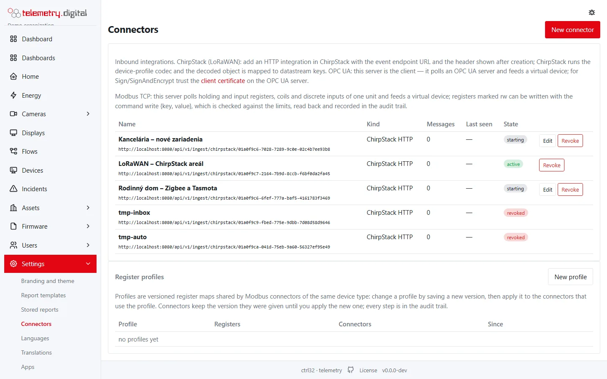
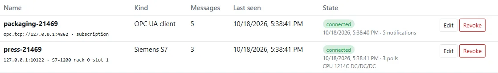
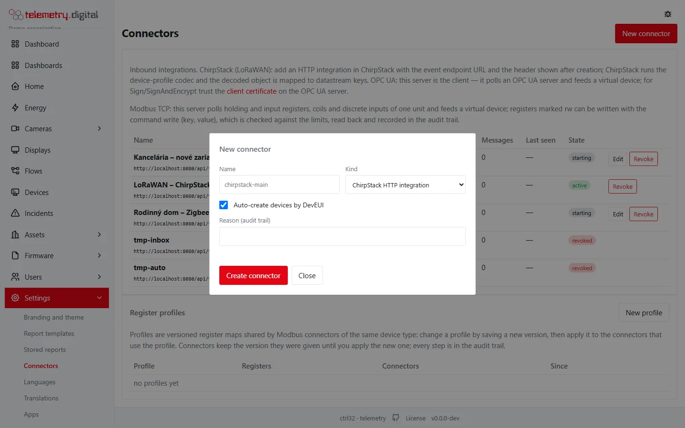
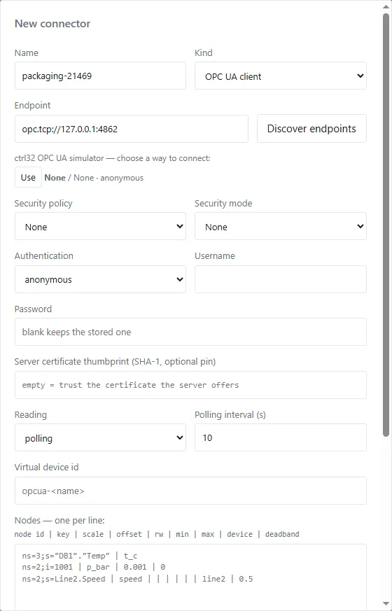
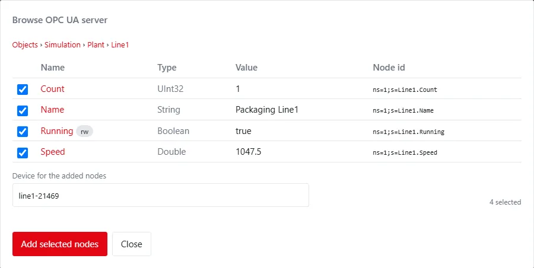
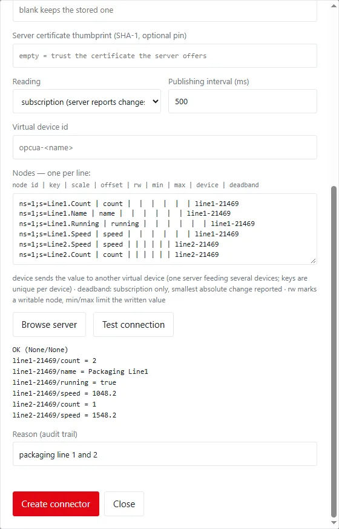
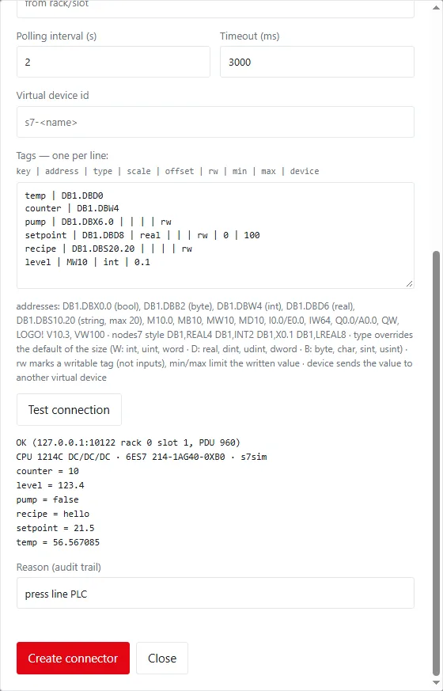

A **connector** is the server reaching out to a device that does not send data on its own — a PLC with an OPC UA
server, a Siemens S7 PLC, a controller with Modbus TCP — or receiving data from a LoRaWAN network server (ChirpStack). Connectors are set
up under **Settings → Connectors**. Each connector feeds a device, so datastreams, alarms, gaps, dashboards and
reports work exactly as with MQTT devices.

Connectors need the permission `config.write`. Every create, change and revocation asks for a **reason** and is in
the audit trail.

## The connector list

| Column | Content |
|---|---|
| Name | the connector's name and its address: the OPC UA endpoint (with *subscription* when it subscribes), `host:port · PLC rack R slot S` for Siemens S7, `host:port unit N` for Modbus, the ingest URL for ChirpStack; for Modbus also the register profile and version, with a warning when a newer version is available |
| Kind | OPC UA client, Siemens S7, Modbus TCP client or ChirpStack HTTP |
| Messages | number of messages received (ChirpStack) |
| Last seen | time of the last message (ChirpStack) |
| State | see below |
| Actions | **Edit** (OPC UA, Siemens S7 and Modbus), **Revoke** |

| State | Meaning |
|---|---|
| active | a ChirpStack connector that accepts messages |
| starting | the poller has not reported yet |
| connecting | the poller is connecting |
| connected | reading works; the time of the last values, the number of polls (or of change notifications for an OPC UA subscription) and the number of unreadable nodes, tags or registers are shown, the last values as a tooltip; for Siemens S7 also the CPU type |
| error | the connection failed; the last error is shown |
| stopped | the poller stopped |
| revoked | the connector was revoked |

**Revoke** asks for a reason and stops the connector for good; a revoked ChirpStack connector refuses its secret.

## New connector

| Field | Default | Limits | Meaning |
|---|:---:|:---:|---|
| Name | — | required, 1–64 characters, unique; cannot be changed later | identifies the connector |
| Kind | ChirpStack HTTP integration | ChirpStack HTTP integration, OPC UA client, Modbus TCP client (polling), Siemens S7; cannot be changed later | which fields follow |
| Reason (audit trail) | — | required | why you made the change |

## ChirpStack (LoRaWAN)

LoRaWAN sensors come in through a **ChirpStack** network server, which decodes their frames with the codec of the
device profile.

| Field | Default | Meaning |
|---|:---:|---|
| Auto-create devices by DevEUI | on | an uplink from an unknown DevEUI creates a device of transport `lorawan` (external id = the DevEUI in lower case, name from ChirpStack or `LoRaWAN <DevEUI>`); when off, such uplinks are refused |

After **Create connector** the dialog shows what to enter in **ChirpStack → Applications → Integrations → HTTP**:

- the **event endpoint URL**, `…/api/v1/ingest/chirpstack/<connector id>?event=up`;
- the header `Authorization: Bearer c32c_…` — the secret is **shown once**.

What the server does with the events:

| Event | Effect |
|---|---|
| up | the decoded object becomes telemetry with the ChirpStack time; RSSI, SNR, frame counter and gateway of the best reception are stored in the device status |
| status | battery level and link margin are stored in the device status |
| other events (join, ack, …) | kept as raw messages of the device |

An uplink without a decoded object (no codec in the device profile) is kept as a raw message. Requests are at most
256 KiB and rate limited; a wrong secret is refused. ChirpStack connectors have no editable settings.

## OPC UA client

The server is the OPC UA client: it connects to an OPC UA server, reads the chosen nodes — every N seconds
(**polling**) or whenever they change (**subscription**) — and feeds one or more virtual devices. One connector reads
one server; add a connector for every further server.

| Field | Default | Limits | Meaning |
|---|:---:|:---:|---|
| Endpoint | — | required, `opc.tcp://host:port/path` | the OPC UA server |
| Security policy | None | None, Basic256Sha256, Basic256, Basic128Rsa15, Aes128_Sha256_RsaOaep, Aes256_Sha256_RsaPss | message security |
| Security mode | None | None, Sign, SignAndEncrypt | policy None requires mode None and vice versa |
| Authentication | anonymous | anonymous, username and password | how the server signs in |
| Username | — | required for username authentication | — |
| Password | — | blank keeps the stored one | stored with the connector |
| Server certificate thumbprint | — | empty or 40 hex digits (SHA-1; colons and spaces are removed) | pins the server certificate: the connector refuses a server that presents another one |
| Reading | polling | polling, subscription (server reports changes) | how values are read |
| Polling interval (s) | 10 | 1–3600 | polling: how often the nodes are read |
| Publishing interval (ms) | 1000 | 100–60 000 | subscription: how often the server reports changes, also the sampling interval of the nodes |
| Virtual device id | `opcua-<name>` | letters, digits and `. _ : -`, at most 128 | external id of the device that receives the values (created automatically with transport `opcua` and the name `<connector> (OPC UA)`) |
| Nodes | — | 1–2000 lines | what to read, see below |

**Discover endpoints** asks the server which security policies, modes and logins it accepts (no session is needed).
**Use** next to an entry fills in the policy, mode and login; for a secured endpoint it also fills in the server
certificate thumbprint, so the certificate is pinned from then on.

### Picking nodes from the server

**Browse server** opens the address space of the server, starting with the *Objects* folder. Folders and objects come
first — click one to open it, the path above the list leads back. Variables show their data type, the current value
and *rw* when they can be written. Tick the variables you need, optionally enter a **Device for the added nodes**, and
click **Add selected nodes**: each becomes a line with a key made from its name (unique on that device). Nodes are
added read-only; add `rw` to the lines you want to write. At most 2000 children of one node are shown.

### Nodes

Each node is one line `node id | key | scale | offset | rw | min | max | device | deadband`:

| Part | Required | Meaning |
|---|:---:|---|
| node id | yes | `ns=<n>;i=<number>`, `ns=<n>;s=<string>`, `ns=<n>;g=<guid>` or `ns=<n>;b=<base64>` (the `ns=` part may be omitted) |
| key | yes | the datastream key, `^[a-z][a-z0-9_]{0,31}$`, unique per device |
| scale | no | the read value is multiplied by it |
| offset | no | added after scaling |
| rw | no | `rw` marks a writable node |
| min, max | no | limits of a written value (scaled); min must not exceed max |
| device | no | external id of another virtual device that receives this value — one server (for example a gateway or a line controller) can feed several devices; the device is created automatically |
| deadband | no | subscription only: the smallest absolute change the server reports (≥ 0) |

Numbers are scaled; booleans, strings and localized texts are stored as they are, times as ISO text. Float values are
stored as their shortest decimal (21.5, not 21.500000953674316).

**Test connection** connects with the current form values, reads the nodes once and disconnects. It shows the
security that was used (and the server certificate thumbprint for secured endpoints), each key with its value — as
`device/key` for nodes of another device — and the nodes that could not be read. Use it before saving.

For **Sign** or **SignAndEncrypt** the server uses its own client certificate (application URI
`urn:ctrl32:telemetry:opcua-client`). Download it with the link *client certificate* on the Connectors page and trust
it on the OPC UA server.

Nodes that cannot be read are reported, not fatal. A lost connection is retried after 5 seconds, then 10, 20, … up to
about a minute; a subscription is created again after a reconnect.

!!! note "The server must reach the PLC"
    With OPC UA and Modbus the server is the client. A server in a data centre cannot reach a PLC behind a NAT —
    install the server at the site (see [Cloudflare Tunnel](../getting-started/cloudflare-tunnel.md)) or connect the
    site's router to the server's [VPN](../vpn/index.md) as a site peer — the server may always reach site networks.

## Siemens S7

The server reads data blocks, merkers, inputs and outputs of a Siemens PLC over S7comm (ISO-on-TCP, port 102) every N
seconds and feeds one or more virtual devices: S7-300, S7-400, S7-1200, S7-1500, ET 200SP CPU and LOGO! 0BA8 and newer.
Values are read by absolute address, so no project file is needed.

!!! note "S7-1200 and S7-1500: allow PUT/GET"
    In TIA Portal open the CPU → *Protection & Security* → *Connection mechanisms* and tick *Permit access with
    PUT/GET communication from remote partner*. Data blocks you read must have *Optimized block access* switched off
    (block properties → *Attributes*), otherwise their variables have no fixed address. Without PUT/GET the connector
    reports an error that says so.

| Field | Default | Limits | Meaning |
|---|:---:|:---:|---|
| Host | — | required, host name or IP address | the PLC |
| Port | 102 | 1–65535 | — |
| PLC | S7-1200 | S7-1200, S7-1500, S7-300, S7-400, ET 200SP CPU, LOGO! 0BA8 and newer, other | sets the default rack and slot (S7-300 0/2, S7-400 0/3, S7-1200, S7-1500 and ET 200SP 0/1) or the TSAPs (LOGO! local 01.00, remote 02.00) |
| Rack | from PLC | 0–7 | overrides the default |
| Slot | from PLC | 0–31 | overrides the default (an S7-1500 may also use slot 0) |
| Connection type | PG | PG, OP, S7 basic | the connection resource of the CPU |
| Local TSAP, Remote TSAP | — | hex such as `01.00`, `0x1000` or `1000` | override rack and slot; for LOGO! as set in LOGO!Soft Comfort (server connection) |
| Polling interval (s) | 10 | 1–3600 | how often the tags are read |
| Timeout (ms) | 3000 | 100–30 000 | per request and for the connection |
| Virtual device id | `s7-<name>` | letters, digits and `. _ : -`, at most 128 | external id of the device that receives the values (created automatically with transport `s7` and the name `<connector> (S7)`) |
| Tags | — | 1–2000 lines | what to read, see below |

Each tag is one line `key | address | type | scale | offset | rw | min | max | device`:

| Part | Default | Meaning |
|---|:---:|---|
| key | — | the datastream key, `^[a-z][a-z0-9_]{0,31}$`, unique per device |
| address | — | see the table below |
| type | from the address | overrides the type implied by the size of the address, see below |
| scale | — | multiplier, must not be 0 |
| offset | — | added after scaling |
| rw | — | `rw` marks a writable tag; inputs (I/E) cannot be writable |
| min, max | — | limits of a written value (scaled); min must not exceed max |
| device | — | external id of another virtual device that receives this value |

Addresses in Siemens notation (English or German mnemonics, upper or lower case):

| Address | Size | Default type | Example |
|---|:---:|:---:|---|
| `DBn.DBXb.x` | bit | bool | `DB1.DBX6.0` |
| `DBn.DBBb` | byte | byte | `DB1.DBB2` |
| `DBn.DBWb` | word | int | `DB1.DBW4` |
| `DBn.DBDb` | double word | real | `DB1.DBD8` |
| `DBn.DBSb.l` | string | string (S7 STRING, at most l characters) | `DB1.DBS20.20` |
| `Mb.x`, `MBb`, `MWb`, `MDb` | merkers | bool, byte, int, real | `M10.0`, `MW10` |
| `Ib.x`/`Eb.x`, `IBb`, `IWb`, `IDb` | inputs | bool, byte, int, real | `I0.0`, `IW64` |
| `Qb.x`/`Ab.x`, `QBb`, `QWb`, `QDb` | outputs | bool, byte, int, real | `Q0.1`, `AW2` |
| `Vb.x`, `VBb`, `VWb`, `VDb` | LOGO! V memory (DB1) | bool, byte, int, real | `V10.3`, `VW100` |

The nodes7 notation works too: `DB1,X0.1`, `DB1,B2`, `DB1,INT4`, `DB1,WORD4`, `DB1,DINT6`, `DB1,DWORD6`, `DB1,REAL8`,
`DB1,LREAL10`, `DB1,CHAR3`, `DB1,S10.20`. The type may only be one of the same size: byte, char, sint, usint for a
byte; int, uint, word for a word; real, dint, udint, dword for a double word; lreal only in nodes7 notation.

**Test connection** connects, identifies the CPU (type and order number, when the CPU tells them), shows the
negotiated PDU size and reads all tags once; tags that cannot be read (a data block that does not exist, an address out
of range) are listed with the reason and do not stop the others. Requests are split to fit the PDU of the CPU, so long
tag lists and strings work on small CPUs too. A lost connection is retried after 5 seconds, then 10, 20, … up to about
a minute.

## Modbus TCP client

The server polls holding and input registers, coils and discrete inputs of one unit — a Modbus TCP device or RTU
devices behind a Modbus TCP gateway — and feeds a virtual device.

| Field | Default | Limits | Meaning |
|---|:---:|:---:|---|
| Host | — | required, host name or IP address, no `/`, `:` or spaces | the device or gateway |
| Port | 502 | 1–65535 | — |
| Unit id | 1 | 1–255 (0 is treated as 1) | the Modbus unit (slave) address |
| Polling interval (s) | 10 | 1–3600 | how often the registers are read |
| Timeout (ms) | 2000 | 100–30 000 | per request |
| Framing | Modbus TCP | Modbus TCP, RTU over TCP (gateway) | RTU over TCP for serial devices behind a transparent gateway |
| Byte order | big (ABCD) | big (ABCD), big words swapped (CDAB), little (DCBA), little words swapped (BADC) | order of 32- and 64-bit values |
| Virtual device id | `modbus-<name>` | — | external id of the device that receives the values (created automatically with transport `modbus` and the name `<connector> (Modbus)`) |
| Register profile | (registers below) | an active profile | take registers and byte order from a profile; the register field becomes read-only |
| Registers | — | 1–500 lines | what to read, see below |

Each register is one line `key | table | address | type | scale | offset | rw | min | max`:

| Part | Default | Meaning |
|---|:---:|---|
| key | — | the datastream key, `^[a-z][a-z0-9_]{0,31}$`, unique in the connector |
| table | holding | holding, input, coil or discrete |
| address | — | 0-based; the value with all its words must fit up to 65535 |
| type | int16 (registers), bool (coils, discrete) | int16, uint16, int32, uint32, float32, int64, uint64, float64 for registers (1, 2 or 4 words); bool only for coils and discrete inputs |
| scale | — | multiplier, must not be 0 |
| offset | — | added after scaling |
| rw | — | `rw` marks a writable register; only holding registers and coils can be writable |
| min, max | — | limits of a written value (scaled); min must not exceed max |

**Test connection** reads all registers once and shows the address, the unit, each key with its value and the
registers that could not be read.

### Register profiles

Devices of the same type share a **register profile** — a versioned register map. The section **Register profiles**
below the connector list shows each profile with its version, description, number of registers (and writable ones),
the connectors using it (with a warning when some use an older version) and since when.

| Field | Default | Limits | Meaning |
|---|:---:|:---:|---|
| Name | — | required, at most 64 characters, unique; fixed after creation | for example the device model |
| Byte order | big | big, big_swap, little, little_swap | as in the connector |
| Description | — | at most 200 characters | — |
| Registers | — | 1–500 lines, same format as in the connector | the register map |
| Changelog | — | at most 500 characters, only for a new version | what changed |
| Reason (audit trail) | — | required | — |

- **New version** saves the changed map as the next version. Connectors keep the version they were given.
- **Apply to connectors** (shown when connectors use an older version) moves every connector of the profile to the
  current version, with a reason; each connector change is audited.
- **Retire** ends a profile that no connector uses any more.

## Writing values

Writing to an OPC UA node, a Siemens S7 tag or a Modbus register is a **command** with the method `write` and the arguments
`{"key": "…", "value": …}`:

- it needs the permission `device.command` and a reason;
- the key must exist on that device and be marked `rw`; the value must fit the type (a number, `true`/`false` for
  coils, boolean nodes and S7 bits, text for strings) and lie within min/max — this is checked **before** anything is
  recorded or written;
- the write uses the connector's open connection; afterwards the server reads the value back, and the command is
  *acked* with the read-back value or *failed* with the error;
- everything is in the audit trail, and with the four-eyes policy for commands a second person approves the write
  first.

Writes can come from dashboard control widgets (knob, slider, switch), process screens, flows, automation rules and
the *Commands* tab of the device page (see [The device page](device-page.md)).

!!! danger "Set points, not safety"
    Use writes to change set points and modes. Never rely on them for anything safety-related: the server is not in
    the control loop and a write can be refused or fail.
