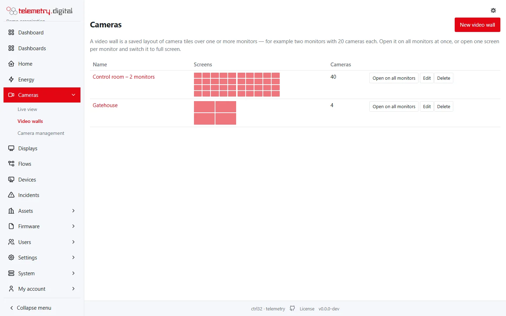
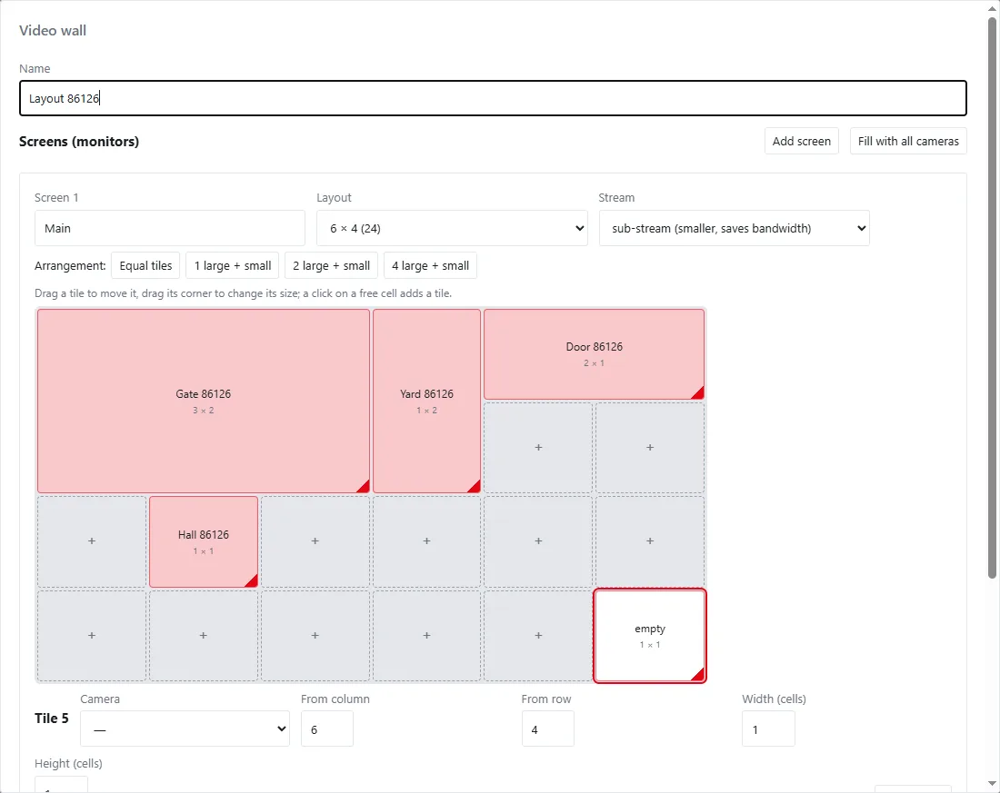
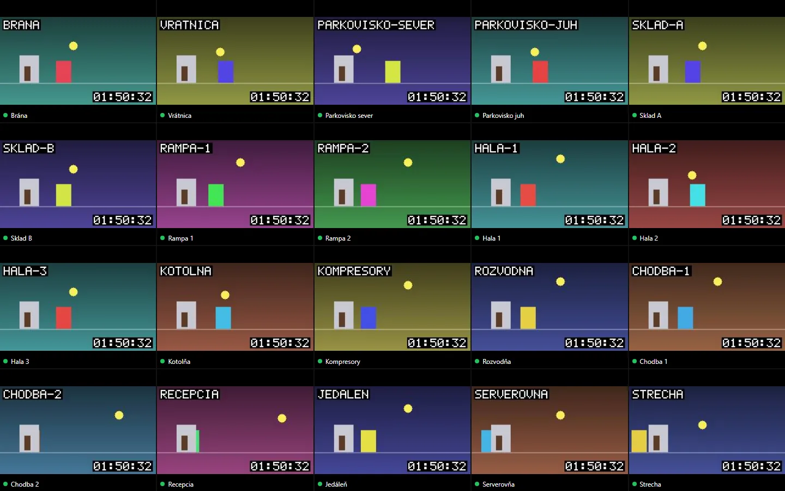
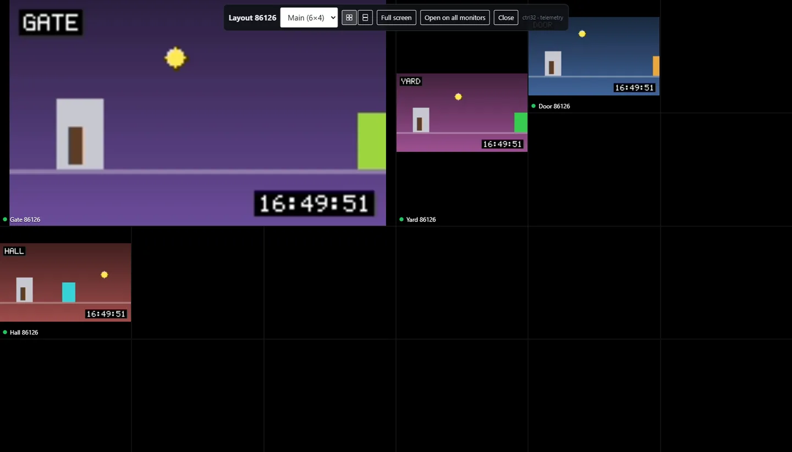
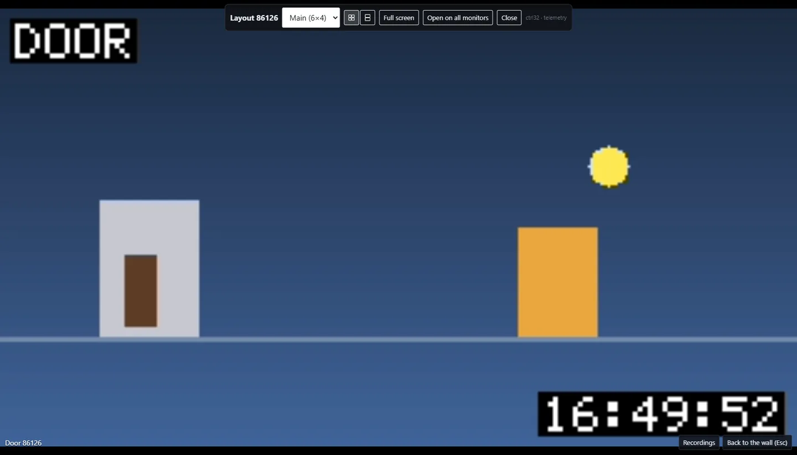
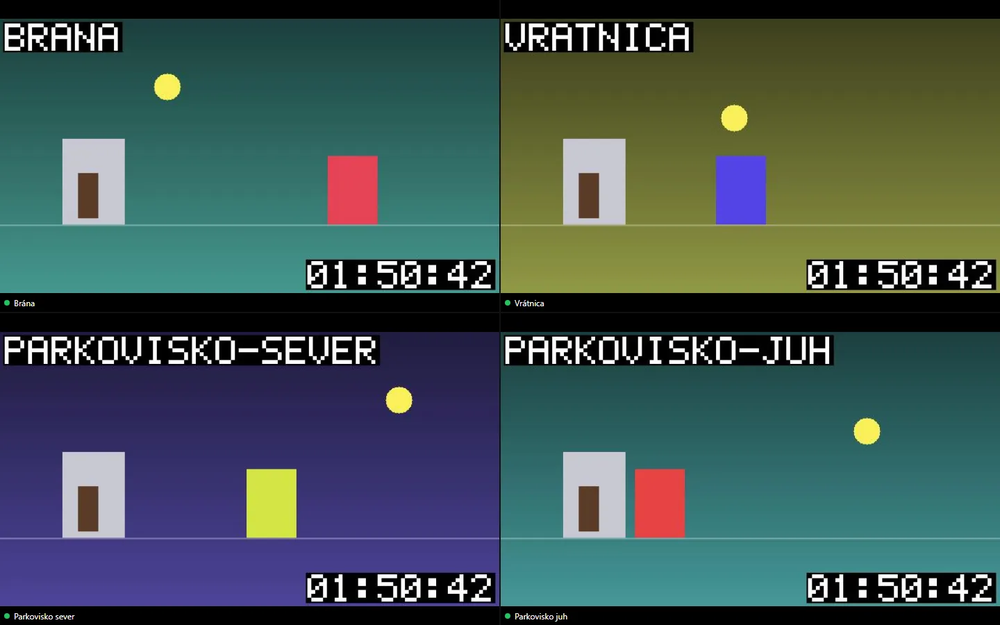
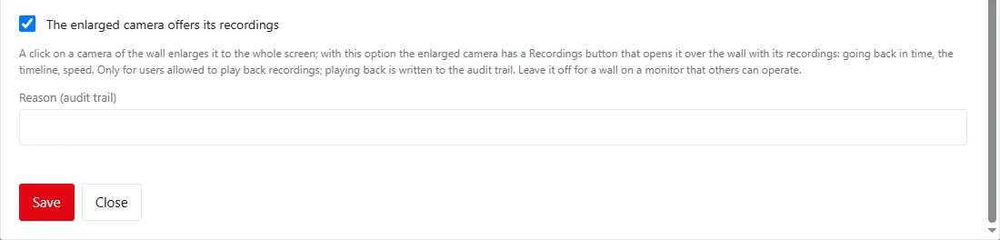
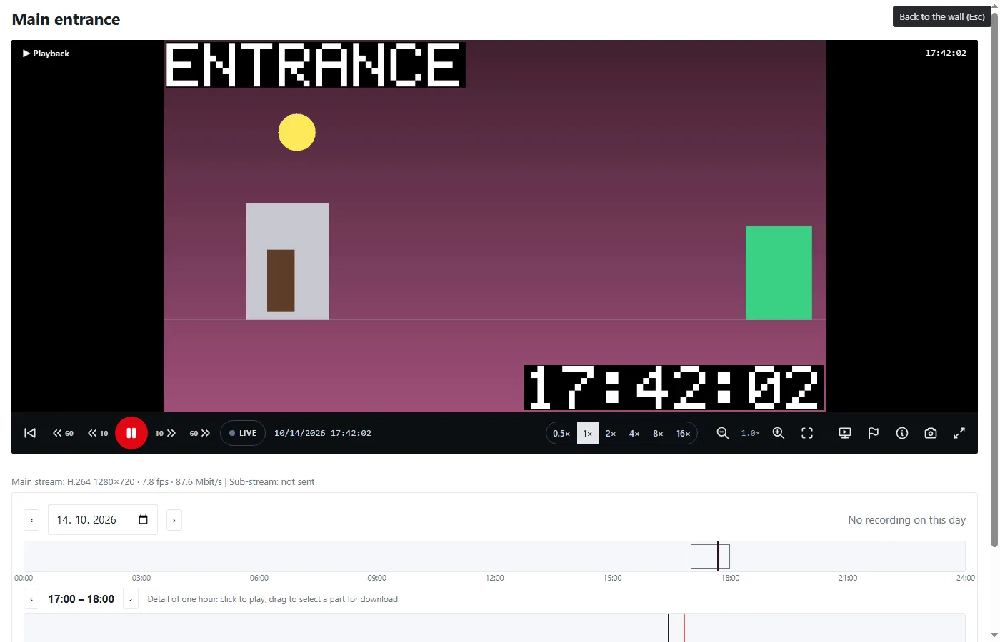
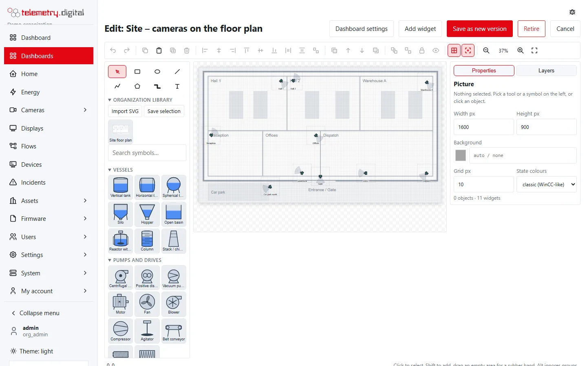
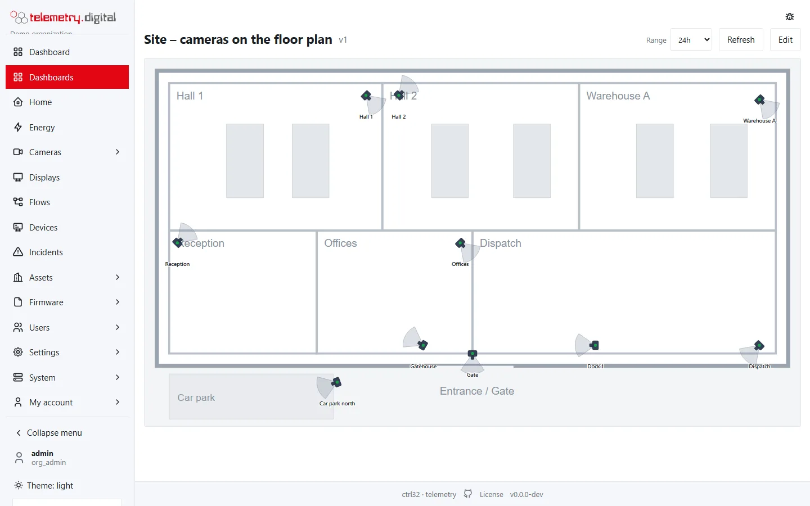

## Video walls

A video wall is a saved layout of camera tiles over one or more monitors. *Cameras → Video walls* lists the walls
with a preview of each screen (click a preview to open that screen) and the number of cameras. Everyone with
`video.view` opens walls; creating, editing and deleting needs `video.manage`.

### Wall fields

*Cameras → Video walls → New video wall*, or *Edit*:

| Field | Default | Limits | Meaning |
|---|:---:|:---:|---|
| Name | — | 1–80 characters | the wall's name |
| Screens | 1 | 1–8 | one per monitor; *Add screen*, *Remove screen* |
| Screen name | Monitor n | ≤ 40 characters | shown in the screen selector of the wall |
| Layout | 3 × 3 | see below | columns × rows of the screen |
| Stream | automatic | automatic, sub-stream, main stream | which stream the tiles play |
| Tiles | empty | one camera or — per tile | the tiles of the screen, each with its camera, place and size — see [Tile layout](#tile-layout) |
| The enlarged camera offers its recordings | off | on, off | the enlarged camera gets a **Recordings** button that opens it with its recordings over the wall — see [Playback from the wall](#playback-from-the-wall) |
| Reason | — | ≤ 200 characters, required | written to the audit trail |

Layouts offered (columns × rows, tiles): 1 × 1 (1), 2 × 1 (2), 2 × 2 (4), 3 × 2 (6), 3 × 3 (9), 4 × 3 (12),
4 × 4 (16), 5 × 4 (20), 6 × 4 (24), 6 × 5 (30), 8 × 5 (40) and 8 × 6 (48).

**Fill with all cameras** puts all enabled cameras on the screens in order — the large tiles first, then the small
ones row by row; free cells get tiles too — and leaves the remaining tiles empty. Deleting a wall needs a reason.

### Tile layout

Every tile has its own **place and size** on the screen's grid, so a screen can mix large and small cameras: for
example one camera over 3 × 2 cells, a tall 1 × 2 camera beside it and single cells around them. The grid is the
screen's layout (columns × rows); a tile covers any rectangle of whole cells, tiles never overlap and cells without a
tile stay black.

In the editor:

| Action | How |
|---|---|
| Move a tile | drag it; it snaps to the cells and never lands on another tile or off the grid |
| Change its size | drag its bottom right corner |
| Add a tile | click a free cell (marked +), then choose the camera |
| Place it exactly | select the tile and type **From column**, **From row**, **Width (cells)** and **Height (cells)** |
| Choose its camera | select the tile, **Camera** |
| Remove it | select the tile, **Remove tile** |

**Arrangement** sets the whole screen at once; afterwards every tile can still be moved and resized. The cameras
stay: the ones on the largest tiles get the large tiles again, the rest fill the small ones row by row.

| Arrangement | Result |
|---|---|
| Equal tiles | every cell one tile (the plain grid) |
| 1 large + small | one large square tile in the top left corner (one cell smaller than the screen's shorter side), single tiles around it |
| 2 large + small | two large tiles stacked on the left (side by side on top when the screen is too low), single tiles beside them |
| 4 large + small | four large tiles in a square on the left, single tiles beside them |

An arrangement appears only where it suits the grid (on a 3 × 3 screen *2 large + small* does not fit, for
example). Changing the grid keeps the tiles: those larger than the new grid shrink, a tile that would then cover
another is dropped. The preview in the list of walls shows the tiles in their sizes.

Through the API a screen carries `rects` next to `tiles`: one `{x, y, w, h}` per tile (cells from the top left, `x`
and `y` from 0). Tiles must lie on the grid and must not overlap; a screen without `rects` is the plain grid, filled
row by row. See the [API reference](reference.md). A user limited to camera groups can put only cameras of their groups on a wall.

### Which stream the tiles play

| Stream setting | Tiles play |
|---|---|
| automatic | the sub-stream when the screen has **more tiles than** *Video walls: sub-stream above* (default 4, 0–64), otherwise the main stream |
| sub-stream (smaller, saves bandwidth) | always the sub-stream |
| main stream (full quality) | always the main stream |

With the default 4, a 2 × 2 screen plays main streams and a 3 × 3 screen sub-streams. A camera without a sub-stream
plays its main stream. The threshold is set in [Video settings](settings.md).

### Open a wall

- **Open on all monitors** opens one window per screen. In Chrome and Edge the browser asks once for permission to
  place windows and puts each on its own monitor; the first click in each window switches it to full screen. In other
  browsers a message asks you to move each window to its monitor and press F11.
- A single screen opens at `/video/walls/<id>?screen=<n>`, where `n` counts from **0** for the first screen — for
  example one PC per monitor.

On the wall:

- a click on a tile enlarges that camera to the whole monitor with the **main stream** — on every wall; **Esc**,
  another click or **Back to the wall** returns. On a wall with **The enlarged camera offers its recordings**, the
  enlarged camera also has a **Recordings** button (below);
- tiles with an event going on are outlined with the event kinds, refreshed every 3 seconds;
- the toolbar — wall name, **screen selector**, **layout** (grid or one camera per row), **Full screen**, **Open on
  all monitors** (the other screens), **Close** — hides together with the pointer after 3 seconds without movement.

*One screen of a control-room wall: 5 × 4 cameras.*

*Tiles of different sizes on one screen.*

*An enlarged camera on a wall that offers recordings.*

*A small 2 × 2 wall for a gatehouse.*

Walls never play sound and always show privacy masks. Wall changes need a reason and are audited.

### Playback from the wall

With **The enlarged camera offers its recordings** switched on in the wall's settings, a click on a tile enlarges the
camera and its **Recordings** button opens it over the wall: live picture, the timeline of its recordings, going back 10 or 60 seconds, speeds 0.5×–16×,
zoom, snapshots and marks — the same player and controls as on the camera page, without the menu.
**Back to the wall** (top right) or **Esc** closes it and the tiles play again. While the playback is open, the wall's
tiles pause, so the wall computer decodes one picture instead of all tiles.

- The option is **off by default**. Leave it off for a wall on a monitor that other people can operate, such as a
  shared screen in a reception.
- It works only for a user with `video.playback`. Others see the enlarged camera without the **Recordings** button,
  even when the option is on.
- Playing back is written to the audit trail (`video.playback`), exactly as on the camera page. Switching the option
  on or off is a wall change with a reason (`video_wall.update`).
- Sound plays only when a user with `video.audio` switches it on in the player. A wall itself never plays sound.
- Displays (paired kiosk computers) do not offer playback. They show live pictures only.
- AI assistants (MCP) can switch the option with the tool `cameras_change` (operation `putVideoWallsId`, field
  `playback_on_click`, with a reason). This needs the same permission and licence as any other change through an
  assistant — see [AI assistants](../ai-assistants/index.md).

!!! tip "Walls that run day and night"
    For a wall without anyone signed in, pair the wall computer as a **display**: it shows wall screens and dashboards
    in turn, enlarges cameras with events and follows operators' commands. See [Displays](../dashboards/displays.md).

## Cameras on a floor plan

A floor plan or site map is a process screen with the plan as a background image and one pin per camera:

1. *Dashboards → New → Process picture*.
2. *Library → Import SVG* — for example a plan exported from a CAD drawing — and place it.
3. *Add widget → Process → Camera on a plan* for each camera.

| Setting | Default | Meaning |
|---|:---:|---|
| Title | — | optional title |
| Camera | — | the camera of the pin |
| Looks towards (degrees) | 90 | direction of the view cone, 0 = up, clockwise |
| Field of view (degrees) | 70 | width of the view cone, drawn between 10 and 180 |
| Length of the view cone | 80 % | 0–100 % |
| Show camera name | on | the name next to the pin |

The pin is **green** when the camera is online, **red** when offline, and **orange, pulsing** while an event is in
progress (the tooltip names the event kinds). A click opens the live picture in a window (privacy masks apply) with
a link to the camera page. Pins of cameras outside your camera groups are not drawn. On a display the window closes
by itself after a minute; public shared dashboards show the pins without state.

*Cameras on a floor plan with their view cones; a click on a pin opens the live picture.*

## Camera widget

Any dashboard or process screen can show a live camera: *Add widget → Other → Camera* (default size 4 × 3).

| Setting | Default | Meaning |
|---|:---:|---|
| Title | — | optional title |
| Camera | — | the camera |
| Stream | sub | `sub` or `main`; use the sub-stream for small widgets |
| Show camera name | on | the name over the picture |
| Open the camera on click | on | a click opens the camera page |
| Show stream information | off | codec, size, fps and kbit/s over the picture |

The widget needs `video.view`. **Public shared dashboards never show cameras.** A user limited to camera groups can
put only cameras of their groups on a dashboard.
